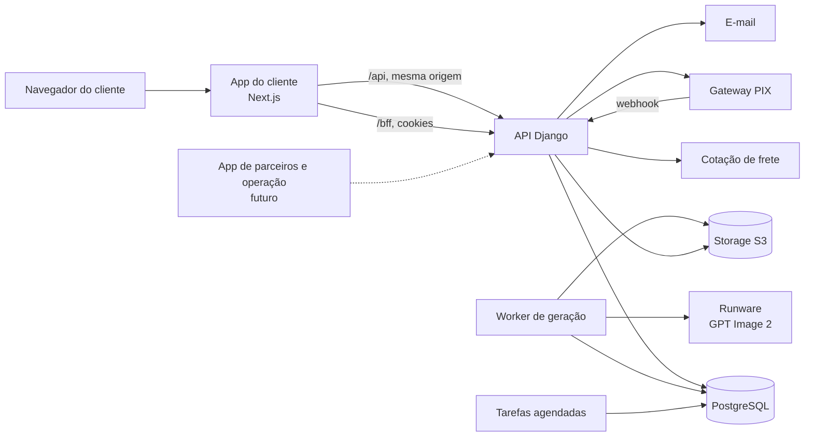
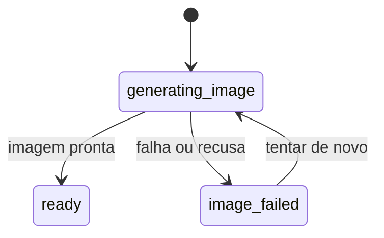
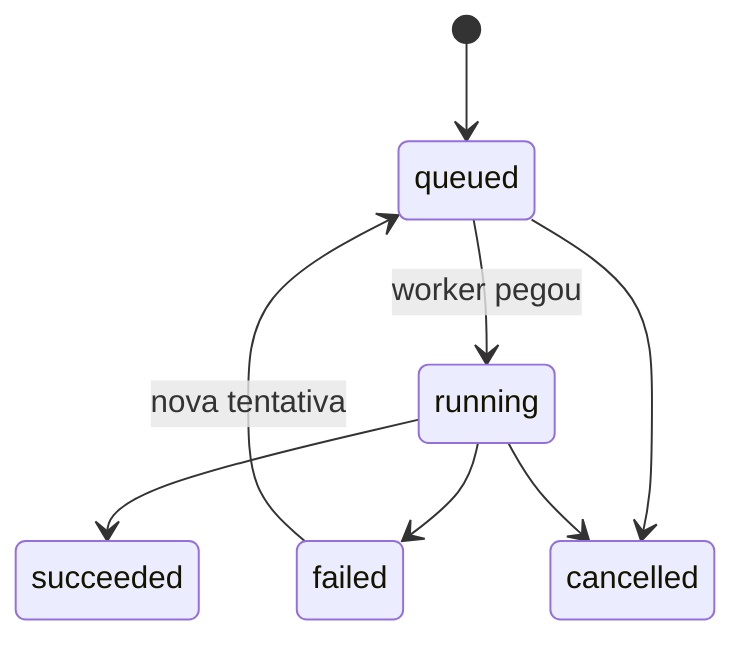
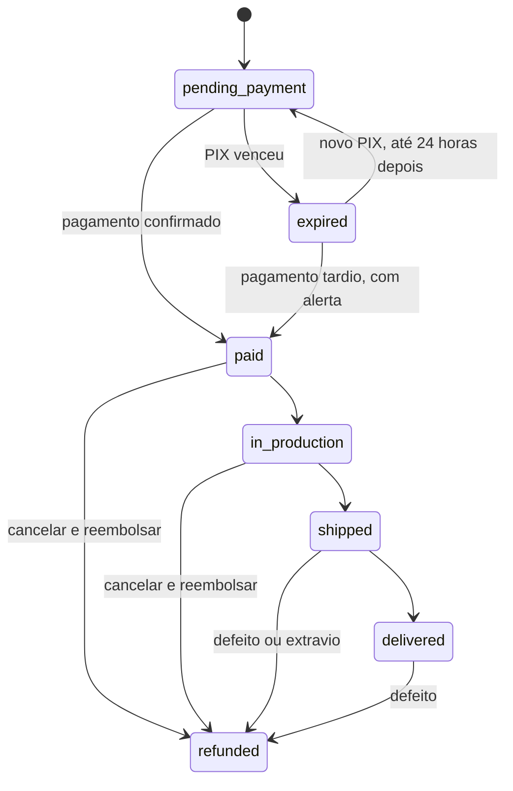

# Arquitetura do MVP da Kubo

| | |
|---|---|
| **Status** | Rascunho para validação |
| **Data** | 04/11/2026, revisado em 05/11/2026 (compra direto do 2D, sem 3D) |
| **Documento irmão** | [PRD do MVP](PRD.md) (o quê e por quê). Este documento trata do como |

> **[Proposta]** marca uma escolha inicial que ainda precisa de validação. **[Verificar]** marca algo que a documentação do fornecedor não esclarece e precisa de teste ou contato.

---

## 1. Visão geral e princípios

Um **monólito modular** em Django atende por API aos apps Next.js. O MVP tem um app, o do cliente, e o app de parceiros entra depois sobre o mesmo backend e os mesmos dados. Um worker separado executa as gerações de IA, que são lentas. **O MVP só gera imagens:** o cliente compra a partir do 2D, e o modelo 3D fica para a preparação de impressão, depois do pagamento. **Funcionalidades de operação não existem neste app nem em painel à parte:** todas ficam no app de parceiros.



### Regras do projeto

1. **O backend decide tudo.** O frontend mostra estado e dispara ações. Regra de negócio e autorização ficam no servidor.
2. **Lógica em `services.py`.** Views só orquestram. Um app Django por domínio.
3. **Toda mudança de status passa pela máquina de estados**, em transação, com evento imutável.
4. **Dinheiro é sagrado.** Valores em centavos inteiros, lançamentos append-only e só o módulo `payments` escreve dinheiro.
5. **Toda capacidade externa fica atrás de um port**, com adapter escolhido por configuração e stub para testes.
6. **Duplo id.** A chave interna é usada em FK e nunca é exposta. A API expõe um UUID (`globalid`) como `id`.
7. **Serializers explícitos**, nunca `fields = "__all__"`. Dados pessoais só saem por regra de visibilidade.
8. **Autorização negada por padrão.** Cada endpoint declara quem pode acessar.
9. **Tipos gerados, nunca escritos à mão.** O contrato OpenAPI gera os tipos do frontend.
10. **Português na interface, inglês no código.** Cor e tipografia só por design tokens. TypeScript sem `any`.
11. **Não abstrair antes da 3ª repetição.**
12. **Sem microsserviços, Redis, Celery ou WebSocket no MVP.** Postgres, processos simples e polling dão conta.

---

## 2. Topologia

| Aplicação | Público | Situação |
|---|---|---|
| `apps/backend` | API, webhooks, worker e tarefas agendadas | MVP |
| `apps/web/consumer` | Clientes | MVP |
| `apps/web/partners` | Parceiros e toda a operação interna | Próximo passo, quando o app do cliente estiver pronto |

Cada app web tem domínio próprio, portanto cookies e sessões são independentes. O Next reescreve `/api/*` para o Django, então o navegador fala sempre com a mesma origem e não há CORS a configurar.

---

## 3. Stack

| Camada | Escolha |
|---|---|
| **Backend** | Python 3.12, Django 5.2, Django REST Framework, SimpleJWT, drf-spectacular, django-filter, django-environ, structlog, requests, boto3, Pillow |
| **Banco** | PostgreSQL 16 |
| **Frontend** | Next.js 15 (App Router), React 19, TypeScript estrito, Tailwind 3, componentes Radix no padrão shadcn, TanStack Query 5, Zustand 5, React Hook Form + Zod, sonner, lucide |
| **Contrato** | drf-spectacular → openapi-typescript → openapi-fetch |
| **Ferramentas** | pnpm (workspace, via `npx`), uv, Makefile, ruff, pytest + factory_boy + freezegun + responses, ESLint, Vitest + Testing Library, GitHub Actions |
| **Serviços externos** | Runware (IA), AbacatePay (PIX), Melhor Envio (frete) [Proposta], storage compatível com S3, SMTP transacional |

As versões exatas ficam nos arquivos de lock. PostGIS não é necessário, porque nenhuma regra do MVP depende de geolocalização.

---

## 4. Repositório

```
apps/
  backend/
  web/
    consumer/                 app do cliente
    partners/                 futuro
    packages/
      ui/                     componentes visuais, nunca importa web-core
      web-core/               sessão, auth, BFF, guards, layout base
      analytics/              eventos de produto
packages/
  api-types/                  schema.yaml e tipos gerados, nunca editados à mão
  api-client/                 cliente tipado e renovação de sessão
  design-tokens/              paleta, tokens CSS e preset do Tailwind
docs/
prototipo/                    removido quando houver paridade
Makefile
pnpm-workspace.yaml
```

- Os apps consomem os pacotes como código-fonte (`transpilePackages`), sem etapa de build própria.
- Um pacote `features`, com domínios compartilhados entre apps, só nasce quando existir o segundo app.
- Comandos do Makefile: `dev`, `backend`, `frontend`, `worker`, `types`, `migrate`, `makemigrations`, `test`, `lint`, `fmt`.

---

## 5. Módulos do backend

Cada módulo segue o formato `models.py`, `services.py`, `serializers.py`, `views.py`, `urls.py`, `tests/`.

| Módulo | Responsabilidade |
|---|---|
| `common` | `BaseModel`, `AppendOnlyModel`, engine da máquina de estados, erros, permissões, identificação do ator, paginação, request id |
| `accounts` | Usuário, papéis, autenticação, códigos por e-mail, visitante, transferência para conta, perfil, exclusão |
| `catalog` | Tamanhos, preços, filamentos, prompts e estilos versionados |
| `creations` | Criações, versões de imagem, tarefas de IA, cotas, teto de gasto, worker |
| `media` | `Asset`, upload, URLs assinadas e retenção |
| `orders` | Carrinho, pedido, itens, endereço, link de acompanhamento |
| `payments` | Cobrança, webhook, lançamentos, reembolso. Único a escrever dinheiro |
| `shipping` | Cotação de frete, snapshot e rastreio |
| `fulfillment` | Parceiro, membros, tarefa de produção, arquivos de produção e envio |
| `notifications` | E-mails transacionais e registro de envio |
| `analytics` | Eventos de produto do funil, fora do alcance do `DomainEvent` |
| `audit` | `DomainEvent` genérico |
| `integrations` | Ports, adapters e credenciais renováveis de fornecedores |

**Direção das dependências:** `orders` depende de `catalog`, `creations` e `shipping`. `payments` depende de `orders`, e `fulfillment` é acionado pelo pagamento. Nenhum módulo importa views de outro, só services.

---

## 6. Identidade

Dois tipos de ator convivem. A API resolve quem é o ator em `request.actor`, e a posse de um recurso é sempre verificada contra ele.

### Visitante

- Token opaco e aleatório, **guardado em cookie httpOnly** `kubo_visitor` (`SameSite=Lax`, `Secure` em produção, validade de 1 ano). No banco fica apenas o hash.
- A rota `/bff/visitor` do Next cria o visitante no primeiro acesso e grava o cookie. Nas chamadas seguintes, o rewrite de `/api/*` repassa o cookie ao Django, lido pela classe `VisitorAuthentication`.
- **Proteção contra CSRF:** como esse cookie autentica sozinho, escritas de visitante exigem também o cabeçalho `X-Kubo-Client`, que um formulário de outro site não consegue enviar.
- A criação do visitante não consome nada.

### Conta

- E-mail e senha, com **access token JWT de 30 minutos guardado só em memória** e **refresh de 7 dias, rotativo e com blacklist, em cookie httpOnly** `kubo_refresh`.
- O cookie é gravado pelo BFF do Next. Cada app expõe `bff/auth/{login,refresh,logout,verify-email}`, reexportando o handler compartilhado de `web-core`.
- Ao carregar a página, o `SessionBootstrap` chama o refresh e depois `/api/me/`. O cliente de API repete a chamada uma vez em caso de 401, renovando a sessão antes.
- O cadastro não retorna tokens: envia um código de 6 dígitos, e a verificação entrega os tokens.
- **Códigos:** guardados com hash, uso único, 15 minutos de validade, 5 tentativas e 60 segundos entre reenvios.
- **Recuperação de senha:** por código, invalida todos os refresh tokens e não revela se a conta existe.

### Transferência para a conta

Ao verificar o e-mail ou entrar com conta, `POST /api/me/claim/` faz, em uma transação:

1. Move as criações e o carrinho do visitante atual para o usuário.
2. Vincula os pedidos sem dono cujo `customer_email` seja igual ao e-mail **verificado**.

Só o e-mail verificado dá direito a pedidos antigos. A operação é idempotente.

### Convidado

Cada pedido tem um token aleatório, com hash no banco, enviado no e-mail como link para `/acompanhar/[token]`. Esse link dá **apenas leitura**: status, itens, rastreio e endereço mascarado. A página usa `Referrer-Policy: no-referrer`.

Quem ainda está com a sessão de visitante que fez o pedido também pode vê-lo.

---

## 7. Papéis e autorização

- **Tabela `Role`:** uma linha por usuário e papel.

| Papel | Situação | Uso |
|---|---|---|
| `staff` | Reservado | Operação no app de parceiros |
| `admin` | Reservado | Inclui `staff`. Gerencia preços e parâmetros |
| `partner_owner` | Reservado | Dono de um parceiro |
| `partner_operator` | Reservado | Membro operacional de um parceiro |

- **Cliente não é papel.** Ser dono de uma criação ou de um pedido deriva da relação.
- **Uma tabela `User` para todos.** Não há tipos de conta separados. Papéis são concedidos por ação administrativa, e o token não carrega papéis: eles vêm de `/api/me/`.

**Camadas no backend:**

1. Padrão global `DenyAll`.
2. Classes de capacidade combináveis por endpoint: `IsActorOwner` no MVP; `IsStaff` e `IsPartnerMember` com o app de parceiros.
3. `scope_queryset`, que limita cada consulta ao que o ator pode ver.
4. Guards da máquina de estados nos services.
5. Regras de visibilidade de dados pessoais nos serializers.

**No frontend:** rotas de conta usam `AuthGuard`, e o middleware só confere a existência do cookie. Isso melhora a navegação, mas não é segurança: quem decide é o backend.

---

## 8. Modelo de dados

Todo modelo herda `BaseModel` (`id` interno, `globalid` UUID, `created_at`, `updated_at`). Na coluna **Uso**, ● significa preenchido no MVP e ○ significa tabela criada para o futuro.

### Identidade (`accounts`)

| Entidade | Campos principais | Uso |
|---|---|---|
| `User` | email, senha, verificado em, anonimizado em | ● |
| `Role` | user, name, único por par | ● |
| `Profile` | user, nome, telefone | ● |
| `VerificationCode` | email, finalidade, hash, expira em, tentativas | ● |
| `Visitor` | hash do token, primeira e última atividade, hash do IP, user (quando transferido) | ● |

### Criação (`creations`, `media`)

| Entidade | Campos principais | Uso |
|---|---|---|
| `Creation` | user **ou** visitor, status, estilo, versão atual, excluída em | ● |
| `CreationInput` | creation, texto do cliente, foto (`Asset`), aceite dos direitos com data e IP | ● |
| `ImageVersion` | creation, parent (árvore de versões), origem (`text`, `photo`, `edit`), instrução, asset, tarefa | ● |
| `ProviderTask` | creation, tipo, provedor, modelo, status, tentativas, próxima tentativa, prompt renderizado, versão do prompt, parâmetros, custo em USD, início e fim, erro, trava (`locked_until`) | ● |
| `QuotaReservation` | ator, hash do IP, tipo, dia, estado (`reserved`, `consumed`, `released`), tarefa | ● |
| `Asset` | bucket, chave, tipo, MIME, tamanho, sha256, visibilidade, classe de retenção, expurgado em | ● |

### Catálogo (`catalog`)

| Entidade | Campos principais | Uso |
|---|---|---|
| `ProductSize` | código, rótulo, maior dimensão em mm, preço em centavos, peso e dimensões da embalagem, ativo, ordem | ● |
| `Filament` | nome, hex, marca, ativo | ○ Hoje só orienta prompts |

**Estilos e prompts ficam em código** (`catalog/prompts.py`), migrados dos ajustes já feitos no protótipo e com uma versão explícita. Mudar um prompt exige novo deploy e reteste contra as referências, e cada `ProviderTask` guarda o texto final enviado.

### Pedido (`orders`, `shipping`)

| Entidade | Campos principais | Uso |
|---|---|---|
| `Cart`, `CartItem` | ator; creation, versão da imagem, tamanho, quantidade | ● |
| `Address` | user, CEP, rua, número, complemento, bairro, cidade, UF | ● Só para contas |
| `Order` | número, user (nulo), `customer_email`, nome, CPF criptografado, telefone, endereço congelado, status, subtotal, frete, total, serviço de frete, prazo prometido, aceite dos termos (versão e data), hash do token de acompanhamento, chave de idempotência | ● |
| `OrderItem` | order, creation, versão comprada, tamanho, quantidade, preço unitário, prompt e estilo congelados | ● |
| `ShippingQuote` | ator, CEP de origem e destino, itens, serviço, preço, prazo, resposta bruta, válido até | ● |

### Dinheiro (`payments`)

| Entidade | Campos principais | Uso |
|---|---|---|
| `Charge` | order, gateway, id externo, status, valor, código PIX, QR Code, expira em, pago em | ● |
| `WebhookEvent` | provedor, id do evento, único por par; tipo, carga, status de processamento | ● |
| `LedgerEntry` | order, charge, tipo, conta de débito, conta de crédito, valor, referência. Append-only | ● |

**Tipos de lançamento:** `product_revenue`, `shipping_collected`, `refund`. Reservado para o futuro: `partner_payable`. Correções são sempre lançamentos compensatórios e saldos são sempre derivados.

### Produção (`fulfillment`)

| Entidade | Campos principais | Uso |
|---|---|---|
| `Partner` | nome, status, CEP de origem | ● Um registro: a própria Kubo |
| `PartnerMember` | partner, user | ○ |
| `ProductionJob` | order item, partner (nulo, atribuível), status, atribuído em | ● |
| `ProductionFile` | job, tipo (GLB, STL, 3MF), versão, asset | ○ Até a preparação de impressão existir |
| `Shipment` | order, partner, transportadora, código de rastreio, postado em, entregue em | ○ Lido pelo cliente, preenchido pelo app de parceiros |

### Auditoria e apoio

| Entidade | Campos principais | Uso |
|---|---|---|
| `DomainEvent` | `aggregate_type`, `aggregate_id`, evento, estado de origem e destino, ator, carga, request id. Append-only | ● |
| `EmailLog` | destinatário, modelo, status, erro | ● |
| `ProductEvent` | ator, nome, propriedades, data | ● |

---

## 9. Máquinas de estado

O engine (`common/fsm.py`) é uma tabela de transições permitidas e uma função `apply_transition`, que executa em uma única transação: bloqueia a linha (`select_for_update`), valida a transição, executa o guard, grava o status, grava o `DomainEvent` e executa os efeitos. Transições ilegais retornam 409 `illegal_transition`. Falha de guard retorna 422 `guard_failed`.

O evento usa `aggregate_type` + `aggregate_id`, então qualquer modelo pode usar o engine sem alterar a tabela de eventos. E-mails são disparados com `transaction.on_commit`, para nunca saírem de uma transação desfeita.

### `Creation`



Em `ready`, a compra já está aberta. Editar não muda o status da criação: a tarefa de edição produz uma nova `ImageVersion`, e só **concluir** altera a versão atual. Itens do carrinho guardam a própria versão, então uma edição posterior não os altera nem invalida. A exclusão é um campo à parte, não um estado.

### `ProviderTask`



### `Order`



### `Charge` e `ProductionJob`

| Modelo | Transições |
|---|---|
| `Charge` | `pending → paid`, `pending → expired`, `pending → failed`, `paid → refunded`, `expired → paid` (tardio). Disputa é marcada com um campo e gera alerta, sem liquidar nem desfazer automaticamente |
| `ProductionJob` | `unassigned → assigned → in_production → ready_to_ship → shipped`. `cancelled` a partir de qualquer estado anterior a `shipped` |

**No MVP**, o pagamento cria os jobs em `unassigned`, e nenhuma tela os avança. As transições de produção e envio só serão acionadas pelo app de parceiros, com o status do pedido derivado dos jobs. Neste app, os estados alcançáveis do pedido são `pending_payment`, `paid`, `expired` e `refunded`.

**Rótulos para o cliente:** `pending_payment` = Aguardando pagamento · `paid` = Recebido · `in_production` = Em produção · `shipped` = Enviado · `delivered` = Entregue · `expired` = Expirado · `refunded` = Reembolsado.

---

## 10. Pipeline de geração

A geração de imagem pode levar até 90 segundos e não pode prender um processo da API. Por isso **a API só cria a tarefa e um worker a executa**.

```mermaid
sequenceDiagram
    participant F as Frontend
    participant A as API
    participant B as Postgres
    participant W as Worker
    participant R as Runware
    participant S as Storage
    F->>A: POST /api/creations/
    A->>B: valida cota e teto; reserva cota; cria tarefa
    A-->>F: 202 com a criação
    loop a cada 2 s
        F->>A: GET /api/creations/{id}/
    end
    W->>B: pega tarefa (SKIP LOCKED)
    W->>R: envia
    R-->>W: imagem
    W->>S: grava
    W->>B: cria versão, debita cota, muda status
```

### Worker

- Comando `python manage.py run_generation_worker`, em processo próprio, com várias threads [Proposta: 8].
- Pega tarefas com `SELECT ... FOR UPDATE SKIP LOCKED` e grava `locked_until` como concessão de tempo. Se o processo morrer, a concessão vence e outro worker assume.
- **2D e edição** são chamadas síncronas no provedor, com timeout de 90 s.

### Fluxo de cada resultado

1. Gravar a imagem no storage imediatamente. A Runware não guarda resultados a longo prazo.
2. Checar o fundo claro, para gerar um aviso sem bloquear. O fundo claro facilita a geração do 3D na produção.
3. Em uma transação, gravar a `ImageVersion`, o custo informado pelo provedor, debitar a cota e avançar a criação para `ready`.

### Falhas

| Situação | Tratamento |
|---|---|
| Erro temporário (timeout, 5xx, 429) | Até 3 tentativas, com espera crescente |
| Conteúdo recusado | Sem nova tentativa. Código próprio e mensagem amigável. Cota liberada |
| Tarefa sem conclusão muito além do limite (2 × 5 min [Proposta]) | A varredura de tarefas presas encerra com código de timeout. Cota liberada |
| Edição cancelada pelo cliente | Tarefa marcada `cancelled`, resultado ignorado. Se já enviada, o custo é registrado e a cota, consumida |

### Cota e teto de gasto

- **Em uma transação na criação da tarefa:** contar `QuotaReservation` de hoje por ator (reservadas + consumidas), aplicar também o limite por IP (com hash) e o limite de tarefas simultâneas e reservar.
- **Teto global:** soma de `ProviderTask.cost_usd` do dia mais a estimativa das tarefas em andamento. Ao ultrapassar o limite, novas gerações recebem 503 `generation_paused`, e um alerta interno é gerado. Os valores ficam em `settings.BUSINESS`.
- **Tarefa presa:** a varredura `reconcile_stuck_tasks` trata tarefas com concessão vencida ou sem atualização.

---

## 11. Ports e adapters

Os ports ficam em `integrations/ports/`, e cada adapter é escolhido por um caminho em settings (por exemplo, `PAYMENT_GATEWAY_ADAPTER=integrations.adapters.abacatepay.AbacatePayAdapter`). O padrão é sempre o fornecedor real. Os testes fixam os stubs, sem rede.

| Port | Operações | Adapter do MVP | Stub |
|---|---|---|---|
| `ImageGenerationPort` | gerar de texto, gerar de foto, editar | Runware (`openai:gpt-image@2`) | Sim |
| `PaymentGatewayPort` | criar cobrança, consultar; reembolsar com o app de parceiros | AbacatePay | Sim |
| `ShippingPort` | cotar | Melhor Envio | Sim |
| `MediaStoragePort` | URL de upload, URL de download, gravar, apagar | S3 | Disco local |
| `EmailPort` | enviar | SMTP | Console |
| `AddressLookupPort` (P1) | buscar endereço por CEP | ViaCEP [Proposta] | Sim |
| `PrintPreparationPort` | gerar o 3D a partir da imagem do pedido, analisar, reparar, multicolor | **Futuro**, só descrito aqui | - |

`GenerationPort` e o adapter da Runware do protótipo são o ponto de partida do `ImageGenerationPort`.

---

## 12. Pagamento

### Fluxo do PIX

1. `POST /api/orders/` com `Idempotency-Key` valida carrinho, tamanhos ativos e frete. Cria o `Order` em `pending_payment` e os itens congelados. A mesma chave retorna o mesmo pedido.
2. `POST /api/orders/{id}/pay/` cria a `Charge` via `POST /v2/transparents/create` (`method: "PIX"`, 30 min). Se já houver uma pendente, reaproveita.
3. O frontend mostra QR Code e copia e cola, e consulta o pedido a cada 3 s.
4. O webhook confirma, e o pedido vira `paid`.

### Webhook (`/api/webhooks/abacatepay/`)

1. **Autenticar:** conferir o `webhookSecret` da query, em comparação de tempo constante. **[Verificar]** A assinatura `X-Webhook-Signature` não é conferida: a documentação usa uma chave pública fixa no exemplo, então ela não prova nada além do segredo. Confirmar com o suporte antes de produção.
2. **Registrar:** inserir `WebhookEvent`, único por (provedor, id do evento). Evento repetido retorna 200 sem efeito.
3. **Localizar** a `Charge` pelo id externo. Sem correspondência: registra, gera alerta interno e retorna 200.
4. **Reconsultar** o status no gateway antes de liquidar.
5. **Liquidar em uma transação:** `Charge` paga, lançamentos no ledger, `Order` em `paid` e `ProductionJob` criado para cada item.

**Regras práticas, conforme a documentação do gateway:**

- Responder 2xx em até 30 s. O gateway repete em caso de timeout, erro de rede, 5xx, 408 e 429, com até 7 tentativas em cerca de 18 horas.
- **Outros 4xx não são repetidos.** Por isso, gateway indisponível na reconsulta retorna 502, para que o evento volte.
- **Nunca responder 410:** isso desativa o webhook.
- **O reenvio manual pelo painel usa um novo `id`.** O status da `Charge` e a existência do lançamento também funcionam como proteção contra duplicidade.
- Eventos tratados: `transparent.completed`, `transparent.refunded`, `transparent.disputed`. Eventos desconhecidos retornam 200 e geram log.

**Status do gateway:** somente `PAID` e `REDEEMED` liquidam. `APPROVED`, `UNDER_DISPUTE` e status desconhecidos nunca liquidam.

### Casos especiais

| Caso | Tratamento |
|---|---|
| PIX não pago | `expire_pending_charges` marca cobrança e pedido como expirados. O carrinho é mantido |
| Webhook perdido | `reconcile_pending_charges` consulta periodicamente cobranças pendentes |
| Pagamento depois de expirar | `expired → paid`, com alerta |
| Segundo PIX pago no mesmo pedido | Cobrança marcada como paga, **sem novo lançamento de receita**, com alerta para devolução |

### Reembolso

Este app não tem tela nem endpoint de reembolso. Até o app de parceiros existir, o reembolso é feito **direto no painel do gateway**. O webhook `transparent.refunded` registra o lançamento compensatório e leva a cobrança e o pedido a `refunded`.

Quando o app de parceiros existir, ele chamará `POST /v2/transparents/refund`, observando que:

- **Só há reembolso integral**: a API não aceita valor parcial.
- É preciso tratar `TRANSACTION_NOT_REFUNDABLE`, `TRANSACTION_UNDER_DISPUTE` e `INSUFFICIENT_FUNDS` (saldo insuficiente), mostrando o erro sem alterar o pedido.

**[Verificar]** Taxas por transação, prazo máximo para reembolso e limites de valor por PIX não constam nas páginas consultadas. Confirmar com a AbacatePay.

**Dados enviados ao gateway:** `customer` é opcional na cobrança PIX. Não enviamos CPF nem dados do cliente, salvo se a conta ou a nota fiscal exigir [Verificar].

---

## 13. Frete

- **Cotação:** `POST /api/v2/me/shipment/calculate` no Melhor Envio. A origem é o CEP do `Partner`, e o destino é o informado pelo cliente. Cada item envia largura, altura, comprimento, peso, valor segurado e quantidade, a partir do `ProductSize`.
- **Usar `custom_price` e `custom_delivery_time`**, que refletem as condições da conta, em vez de `price` e `delivery_time`.
- **Prazo mostrado:** `custom_delivery_time` somado ao prazo de produção em `settings.BUSINESS` (RN-16), e gravado no pedido como prazo prometido.
- **Snapshot:** cada opção vira uma `ShippingQuote`, válida por 30 minutos [Proposta].
- **No fechamento:** o backend cota de novo. Se o valor mudou, retorna 409 `shipping_changed` com o novo valor, e o cliente confirma.
- **Indisponibilidade:** retorna 503 `shipping_unavailable`, e o checkout não avança. Sem tabela de contingência no MVP.
- **Autenticação:** OAuth 2.0 com token de 30 dias. A tarefa `refresh_shipping_token` o renova antes do vencimento. A API exige `User-Agent` com nome da aplicação e e-mail técnico de contato, configurado por variável de ambiente.
- **Fora do MVP:** compra e impressão de etiqueta, e registro do rastreio. Pertencem ao app de parceiros.

**[Verificar]** A referência da API tem inconsistências (como `heigth` e `lenght` em `volumes`). Testar em sandbox e usar `products`.

---

## 14. Preço sem medir a peça

O cliente compra a partir da imagem, sem malha, então **não há estimativa de custo por peça antes da compra** e nenhum tamanho é bloqueado por criação. O preço depende só do tamanho (`ProductSize.price_cents`) e precisa cobrir as peças mais pesadas de cada tamanho.

A tabela é conferida com impressões reais antes do lançamento ([PRD](PRD.md#condições-para-lançar)). Uma medida de volume e custo volta a fazer sentido na preparação de impressão, depois do pagamento, quando a malha existir: ali ela pode alertar a operação sobre pedidos com margem baixa, sem mudar o que o cliente pagou.

---

## 15. Storage e acesso

**Um bucket privado:** fotos, imagens e arquivos de produção, sempre por URL assinada. Miniaturas de estilo são arquivos estáticos do próprio app. Em desenvolvimento, o adapter local serve os arquivos por `/api/media/<token>/`, com token assinado.

Como as URLs assinadas mudam a cada resposta, o frontend reaproveita a URL de cada imagem enquanto ela vale, para o polling não baixar tudo de novo.

- **Upload de foto:** o frontend envia à API, que valida o tipo real, corrige a orientação, reduz a no máximo 1.024 px e grava. O caminho é mais simples que um upload pré-assinado e garante a validação no servidor. A limitação de 10 MB fica no servidor e no Next.
- **Leitura:** a API verifica a posse e devolve URLs assinadas de curta duração (5 min [Proposta]) nos detalhes da criação.
- **Produção:** arquivos e downloads só pelo app de parceiros, com acesso registrado. Nenhum endpoint deste app os entrega.

### Retenção [Proposta, depende de validação jurídica]

| Dado | Sem pedido | Com pedido |
|---|---|---|
| Foto enviada | 90 dias, ou até 30 dias após exclusão | Até o fim do prazo legal e de garantia |
| Imagens geradas | Mantidas, ou até 30 dias após exclusão | Mantidas (RN-28) |
| Prompts, custos e metadados de tarefas | Mantidos. Texto e dados pessoais são removidos a pedido | Mantidos |
| Dados do pedido | - | Conforme obrigações fiscais |
| Visitante inativo | Removido após 12 meses | Relação do pedido preservada |

A tarefa `purge_expired_assets` aplica essas regras e nunca apaga arquivos ligados a um `OrderItem`.

**Volume esperado:** cerca de 1 a 2 MB por imagem PNG de 1.024 px, então o custo de storage não é preocupação inicial.

---

## 16. Frontend

### Estrutura do app

```
apps/web/consumer/src/
  app/
    (public)/              início, criações, carrinho, checkout, acompanhar, institucionais
    (auth)/                entrar, cadastro, verificar-email, recuperar-senha
    (account)/             pedidos, conta (com AuthGuard)
    bff/                   auth e visitor
  components/layout/       app shell, cabeçalho, navegação
  features/
    creations/             {components, hooks, schemas, lib}
    cart/
    checkout/
    orders/
    account/
  middleware.ts
```

### Rotas

| Rota | Função |
|---|---|
| `/` | Início, com a etapa de prompt do protótipo logo na primeira dobra |
| `/criacoes` | Minhas criações |
| `/criacoes/[id]` | **Hub:** mostra a geração ou, com a imagem pronta, a compra ao lado dela |
| `/carrinho`, `/checkout` | Carrinho e checkout. `?item=` limita o checkout a um item (Comprar agora) |
| `/pedidos`, `/pedidos/[id]` | Pedidos da conta ou da sessão. O hub muda conforme o status, inclusive o pagamento PIX |
| `/acompanhar/[token]` | Acompanhamento do convidado |
| `/entrar`, `/cadastro`, `/verificar-email`, `/recuperar-senha` | Conta |
| `/conta` | Perfil e exclusão |
| `/termos`, `/privacidade`, `/trocas`, `/ajuda` | Institucionais |

**Etapas da máquina de estados não viram sub-rotas.** O hub de cada recurso decide o que mostrar. Assim, links de e-mail e recarregamentos sempre chegam ao ponto certo.

### Padrões

- **Dados:** `unwrap(await api.GET("/api/..."))`, chaves só pela fábrica `qk`, tipos por `Schemas["X"]`. `staleTime` de 30 s, sem repetição em 400, 401, 403, 404, 409 e 422.
- **Estado cliente:** Zustand só para a sessão. Criações e pedidos vivem no TanStack Query e no servidor.
- **Polling:** 2 s em criações em andamento, 3 s em PIX pendente, 30 s em pedidos ativos. Para em estados finais.
- **Formulários:** RHF + Zod, com `handleFormError` levando erros do servidor aos campos.
- **Status:** `Record<Enum, {label, tone}>` tipado, para que um status novo sem rótulo seja erro de compilação.
- **PWA:** manifesto básico [P1]. Sem service worker no lançamento.

### Design tokens (`packages/design-tokens`)

| Arquivo | Conteúdo |
|---|---|
| `src/palette.ts` | Cores em hex |
| `styles/tokens.css` | Variáveis CSS em canais RGB e semânticas no padrão shadcn |
| `src/tokens.ts` | Tokens sem cor (raios, sombras) |
| `src/tailwind-preset.ts` | Mapeamento para classes do Tailwind |

Valores vêm do protótipo: `accent #7C3AED`, `accent-soft #F0E9FF`, `highlight #FAFF00`, `highlight-hover #F0F500`, `ink #141414`, `muted #6B6B6B`, `line #E5E5E5`, `sunken #F4F4F4`, `danger #C82828`, fontes Inter e Space Grotesk, raios de 14 e 20 px. **Regra mantida:** amarelo neon só como preenchimento ou sobre roxo, nunca como texto em fundo branco.

### O que migra do protótipo

| Origem em `prototipo/` | Destino | Mudança |
|---|---|---|
| `features/creator/components/prompt-step.tsx` | `features/creations` | Cria a criação na API e abre o hub |
| `features/creator/components/studio.tsx` (inclui `ProgressNotice`) | `features/creations` | Estado vem da API por polling, em vez de memória |
| `features/creator/components/edit-modal.tsx` | `features/creations` | Versões persistidas, cancelamento real |
| `features/creator/components/model-viewer.tsx` | `features/creations` | Mesma configuração de cena; recebe URL assinada |
| `features/creator/components/purchase-panel.tsx` | `features/creations` | Tamanhos e preços da API, bloqueios, carrinho funcional |
| `components/ui/{button,card,popover}.tsx` | `apps/web/packages/ui` | Sem mudança |
| `backend/integrations/ports.py`, `adapters/runware*.py` | `integrations` | Dividido em dois ports. Confirmar o formato de `getResponse` em tarefa real |
| `backend/config/settings.py` (`GENERATION`, `_COLOR_RULE`, `_COLOR_PLAN`, `FILAMENT_COLORS`) | `catalog/prompts.py` | Prompts mantidos, com versão explícita |

**Não migram:** popover de créditos (expunha o saldo do provedor), selo "protótipo", `/models-comparison` e o app `comparison`.

---

## 17. API

**Convenções:**

- Prefixo `/api/`, sem versionamento, com barra final e sem envelope de resposta.
- Paginação por página, 20 por padrão e 100 no máximo: `{count, next, previous, results}`.
- Erros de domínio: `{"detail": "...", "code": "..."}`. Erros de campo seguem o padrão do DRF.
- Ações da máquina de estados: `POST /api/<recurso>/{id}/<ação>/`.
- Dinheiro em centavos inteiros.
- Tarefas longas retornam 202.
- Swagger em `/api/docs/` só fora de produção.
- `make types` regenera `schema.yaml` e os tipos; o CI falha se estiverem desatualizados.

### Endpoints do MVP

| Método e caminho | Ator | Função |
|---|---|---|
| `POST /api/visitors/` | BFF | Cria visitante |
| `POST /api/auth/{register,login,refresh,logout}/` | Público | Conta |
| `POST /api/auth/verify-email/`, `POST /api/auth/verify-email/resend/` | Público | Verificação por código |
| `POST /api/auth/password/{reset,reset/confirm}/` | Público | Recuperação |
| `POST /api/auth/password/change/` | Conta | Troca de senha |
| `GET, PATCH /api/me/` | Conta | Perfil |
| `POST /api/me/delete/` | Conta | Exclusão, com a senha no corpo |
| `POST /api/me/claim/` | Conta | Transferência do visitante |
| `GET /api/me/addresses/` | Conta | Endereços salvos, para o checkout |
| `GET /api/quota/` | Ator | Cota restante |
| `GET /api/catalog/styles/`, `GET /api/catalog/sizes/` | Público | Estilos e tamanhos |
| `GET, POST /api/creations/` | Ator | Listar e criar (texto, foto ou ambos) |
| `GET, DELETE /api/creations/{id}/` | Dono | Detalhe (status, versões, edições) e exclusão |
| `POST /api/creations/{id}/retry/` | Dono | Tentar de novo |
| `POST /api/creations/{id}/edits/` | Dono | Pedir edição a partir de uma versão |
| `POST /api/creations/{id}/edits/{task_id}/cancel/` | Dono | Cancelar edição |
| `POST /api/creations/{id}/apply-version/` | Dono | Concluir com a versão escolhida |
| `GET /api/cart/` | Ator | Carrinho |
| `POST /api/cart/items/`, `PATCH, DELETE /api/cart/items/{id}/` | Ator | Itens |
| `POST /api/shipping/quotes/` | Ator | Cotar por CEP |
| `GET /api/shipping/address/{cep}/` | Público | Preencher o endereço pelo CEP |
| `GET, POST /api/orders/` | Ator | Listar e criar, com `Idempotency-Key` |
| `GET /api/orders/{id}/` | Dono | Detalhe |
| `POST /api/orders/{id}/pay/` | Dono | Criar ou reaproveitar o PIX. Em pedido expirado há menos de 24 horas, gera um novo |
| `GET /api/orders/track/{token}/` | Token | Leitura do convidado |
| `POST /api/orders/track/resend/` | Público | Reenviar link |
| `POST /api/webhooks/abacatepay/` | Gateway | Webhook |
| `POST /api/events/` | Ator | Evento de produto |

---

## 18. Temas transversais

### Sem painel de operação

Não há Django Admin nem outro painel. Tudo que for operação entra com o app de parceiros. Enquanto ele não existe:

- **Preços, tamanhos e parâmetros de custo** vêm de migração de dados e mudam por novo deploy.
- **Alertas internos** ficam no log, marcados com `alert=true`. Ninguém é avisado automaticamente: é preciso consultar o log.
- **Reembolsos** são feitos no painel do gateway (seção 12).

### Tarefas agendadas

Comandos idempotentes, executados pelo container `scheduler` (`manage.py run_scheduler`).

| Comando | Frequência | Função |
|---|---|---|
| `expire_pending_charges` | 1 min | Expira PIX e pedidos |
| `reconcile_stuck_tasks` | 1 min | Recupera tarefas presas |
| `reconcile_pending_charges` | 5 min | Cobre webhooks perdidos |
| `refresh_shipping_token` | Diária | Renova o token de frete |
| `purge_expired_assets` | Diária | Aplica retenção |

### E-mail

Envio síncrono, melhor esforço e fora da transação, com modelos Django e `EmailLog`. Falha não desfaz o pagamento: fica em `EmailLog` e gera alerta interno.

### Segurança

- Rate limit por IP e por e-mail (com hash) em autenticação, **incluindo o refresh**; por visitante em geração, cotação e criação de pedidos.
- **Contadores em cache compartilhado** (`DatabaseCache`), porque o cache padrão por processo não funciona com vários workers.
- Em produção: SSL obrigatório, HSTS, cookies seguros, Referrer-Policy e CSP.
- Segredos só em variáveis de ambiente, com `.env.example` por app.
- Uploads: tipo real verificado e imagem reprocessada no servidor.

### LGPD e dados pessoais

- CPF criptografado no nível do campo e mascarado na interface.
- Logs sem dados pessoais: IPs e e-mails só com hash.
- Exclusão de conta: anonimiza o usuário, aplica a retenção a criações sem pedido e preserva o que a obrigação fiscal exige.
- Aceites de termos e de direitos sobre fotos ficam registrados com versão e data.
- Fotos seguem para provedores no exterior, o que deve constar da política de privacidade.
- **Parceiros futuros:** veem apenas nome e endereço para envio, por meio de serializers próprios.

### Observabilidade

- `structlog` **configurado** para JSON, com `request_id`, `user_id` e `visitor_id` por contextvars, a partir de um middleware de `X-Request-ID`.
- Erros da API e do worker ficam no log. Não há rastreamento de erros externo.
- Trilha de negócio: `DomainEvent`. Funil: `DomainEvent` + `ProductEvent`. Custo: `ProviderTask`.
- Alertas internos, só no log e sem tela neste app: teto de gasto, webhook sem correspondência, PIX duplicado, disputa, muitas falhas de geração.

### Testes

- **Backend:** um arquivo de teste por endpoint, com matriz de permissões (anônimo, outro visitante, dono, conta), regras de negócio e `code` do erro. `conftest.py` fixa adapters offline.
- **Críticos:** idempotência de webhook, corrida entre workers, reserva de cota, teto de gasto, transferência para conta e acesso cruzado a recursos de outro visitante.
- **Estimativa de volume:** testes com malhas conhecidas (esfera íntegra, esfera com furo).
- **Frontend:** Vitest + Testing Library, com testes próximos ao código. Sem E2E automatizado no MVP; o fluxo completo é conferido manualmente antes do lançamento.
- **Fluxo de cada mudança:** tipos → service → endpoint/UI → teste. Conventional Commits e PRs pequenos.

### Ambientes e deploy

| Item | Decisão |
|---|---|
| **Ambientes** | Local (IA real; pagamento e frete simulados até existirem as chaves), homologação (gateway em modo de teste e frete em sandbox), produção |
| **Empacotamento** | Docker, com imagens para `web` (gunicorn), `worker`, `scheduler` e `consumer` (Next) |
| **Hospedagem** | VPS com Docker Compose, Postgres gerenciado e storage S3 compatível [Proposta] |
| **CI** | Backend: ruff, verificação contra `__all__`, migrações, pytest, geração de schema. Web: lint, typecheck, teste, build |
| **Migrações** | Executadas no deploy, antes de subir a nova versão |
| **Backup** | Backup diário do banco com teste de restauração. Versionamento no bucket privado |
| **Desenvolvimento** | `make db` sobe um Postgres local sem Docker, na porta 5433 |

---

## 19. Terreno preparado para os parceiros

| Já no MVP | Falta construir |
|---|---|
| Monorepo com `ui`, `web-core`, `api-client`, `api-types` e `design-tokens` compartilháveis | `apps/web/partners`, usando esses pacotes |
| Pedidos, cobranças, eventos e tarefas de IA completos no banco | **Toda a operação:** pedidos, arquivos, status, rastreio, reembolso, remoção de conteúdo, preços e parâmetros |
| Tabela única de usuários, papéis reservados, login via BFF reaproveitável | Candidatura e aprovação de parceiros |
| `Partner`, `PartnerMember`, `ProductionJob`, `ProductionFile`, `Shipment` | Telas e endpoints `/api/partner/...` com `IsPartnerMember` e escopo |
| `ProductionJob.partner` nulo e atribuível, com cada atribuição em `DomainEvent` | Regra de atribuição: manual e depois automática |
| Máquina de estados e eventos genéricos | Status do pedido derivado dos jobs |
| Imagem, modelo, prompt e estilo congelados por item | `PrintPreparationPort` e pipeline que preenche `ProductionFile` |
| Ledger com tipo `partner_payable` reservado | Repasse a parceiros |
| Serializers explícitos e regras de PII | Serializer do parceiro: sem e-mail nem CPF do cliente |

**Por que entra sem migração destrutiva:** o app novo acrescenta endpoints e telas sobre tabelas que já existem. Pedidos do MVP ficam ligados ao parceiro interno (a própria Kubo), e cada tamanho, arquivo e evento já está registrado por item.

---

## 20. Decisões em aberto

| # | Questão | Situação |
|---|---|---|
| 1 | Como a imagem vira peça (provedor 3D, reparo, cores e fatiamento), já que a preparação ficou fora do MVP | Depende do teste de impressão |
| 2 | Chave usada na assinatura do webhook; taxas, limites e prazo de reembolso do gateway. Hoje o webhook autentica só pelo segredo: a chave de assinatura documentada é pública e não prova nada além dele | Confirmar com a AbacatePay |
| 3 | Dados de cliente exigidos pelo gateway e pela nota fiscal | Confirmar |
| 4 | Conta no Melhor Envio e serviços oferecidos (PAC, SEDEX, transportadoras) | Definir e testar em sandbox |
| 5 | Prazos de retenção e redação de termos | Revisão jurídica |
| 6 | Hospedagem e domínios definitivos. Os arquivos Docker existem, mas não foram executados | Decidir e testar antes de homologação |
| 7 | Limites de cota e teto de gasto | Ajustar com dados reais |

---

## 21. Glossário técnico

| Interface (pt) | Código (en) |
|---|---|
| Criação | `Creation` |
| Versão | `ImageVersion` |
| Tarefa de IA | `ProviderTask` |
| Visitante | `Visitor` |
| Cota | `QuotaReservation` |
| Tamanho | `ProductSize` |
| Pedido, item | `Order`, `OrderItem` |
| Cobrança | `Charge` |
| Lançamento | `LedgerEntry` |
| Parceiro | `Partner` |
| Tarefa de produção | `ProductionJob` |
| Envio | `Shipment` |
| Evento de domínio | `DomainEvent` |

### Referências de fornecedores

- [AbacatePay: webhooks](https://docs.abacatepay.com/pages/webhooks) e [reembolso de checkout transparente](https://docs.abacatepay.com/pages/transparents/refund)
- [Melhor Envio: autenticação](https://docs.melhorenvio.com.br/docs/autenticacao) e [cálculo de frete](https://docs.melhorenvio.com.br/reference/calculo-de-fretes-por-produtos)
- [Runware: termos](https://runware.ai/terms)
