# Meshy Shop (meshy.ai/shop): mapeamento completo

> Estudo de um concorrente direto do Kubo, feito em 01/11 e 02/11/2026 usando o site de verdade: um Chrome controlado por script no PC do Jeferson, em português e com preços do Brasil.
>
> **Sem login (01/11):**
> - **8 fotos**, cada uma gerando 4 designs (32 imagens), até **estourar o limite diário**;
> - **8 modelos 3D**, 7 deles depois de o limite estourar;
> - o carrinho e o checkout, com frete para Brasil e EUA (parei antes de pagar);
> - o FAQ, os termos, o Creative Lab e a Pockella.
>
> **Com login e no celular (02/11):**
> - a conta grátis do Jeferson, com **8 tentativas de design** (6 prontas e 2 recusadas) e **5 modelos 3D**, cobrindo chaveiro, casal e personagem protegido ([seção 11](#11-com-login-conta-cota-e-pedidos));
> - a versão mobile, do início até o frete ([seção 12](#12-versão-mobile)).
>
> Também capturei o tráfego da API e li o JavaScript do site.
>
> - Os prints estão em [prints/desktop/](prints/desktop/) e [prints/mobile/](prints/mobile/).
> - A **referência técnica completa** (endpoints, payloads, códigos de erro) está em [meshy-api.md](meshy-api.md).
> - O que **não** testei está na [última seção](#como-este-estudo-foi-feito--limites).

## Resumo em 10 pontos

1. **O que é:** a loja de presentes da própria Meshy, a empresa de IA 3D. O cliente envia uma foto e recebe uma figura chibi ou um chaveiro de pet impresso em cores. A impressão e o envio ficam com terceiros, segundo os termos.
2. **Fluxo central:** foto → **4 designs 2D** (~30 s) → cliente escolhe um → **"Faça este em 3D"** (~1 min) → tamanho → checkout. Ao contrário do Jujubit, o 2D **precisa ser aprovado** antes do 3D. É o mesmo desenho do fluxo-alvo do Kubo.
3. **Só foto.** Não há prompt, estilo, edição por chat nem regeneração de um design específico. O único texto é o nome do pet, no chaveiro.
4. **Não exige login para gerar nem para comprar.** O site cria uma sessão de convidado, e o pedido vira conta pelo e-mail do checkout. Com login, a loja quase não muda: cota um pouco maior, designs na conta e a lista de pedidos (seção 11).
5. **Limite de 8 fotos por dia para convidado, compartilhado entre os produtos.** Com o limite estourado, o 3D **continua liberado**: fiz mais 7 sem bloqueio. Numa conta grátis são **10 designs de figura por dia**, renovados às 21h de Brasília, e a loja não gasta os créditos da conta.
6. **Quem gera o 3D é a própria Meshy:** `texture_ai_model: "blueberry"`, que no código do site é o Meshy 7. O 3D costuma levar de 51 a 99 s, com dois casos perto de 5 min. A única exceção ao Meshy 7 foi o casal, que saiu com o Meshy 6 (`avocado`).
7. **Um classificador decide o que pode ser vendido, mas só avisa depois de gastar.** O veredito (`subject_type`) já existe nos primeiros segundos do 3D, mas o processo vai até o fim, e só então a compra some. Ele também erra: **uma xícara com carinha passou como "1 pessoa"** e pode ser comprada. Já a imagem do Mickey foi recusada ainda no 2D, com um aviso genérico e a cota devolvida.
8. **O arquivo da prévia é protegido:** vem em `.meshy`, um formato próprio aberto por um worker de `decrypt`. O cliente vê o 3D, mas não recebe um GLB. Não tentei decifrar.
9. **Preço:** figura de pessoa de R$ 188 (6 cm) a R$ 851 (12 cm), pet de R$ 227 (4 cm) a R$ 801 (8 cm), duas pessoas de R$ 271 a R$ 492, chaveiro por R$ 216. Frete de **R$ 26** para o Brasil. A promessa é de envio em 7 a 10 dias, e a tela calculou chegada em ~21 dias.
10. **Para o Kubo, o ponto mais sensível é estratégico:** a Meshy, único provedor 3D planejado, vende o mesmo tipo de produto final. Ao mesmo tempo, ela oferece a mesma tecnologia por API "para negócios", com a frase "você traz a loja e o fulfillment" (seção 10).

---

## 1. Estrutura do site

| Menu | Conteúdo |
|---|---|
| **Todos** | Figura chibi (Pessoas, Pets, Duas pessoas), Chaveiro de pet, Avaliações reais, Ajuda |
| **Rastrear pedido** | `/shop/orders`: pede login com o e-mail usado no checkout |
| **Ajuda** | `/shop/faq`: Criando, Pedido e pagamento, Envio e entrega, Refazimentos e reembolsos |
| Topo | Carrinho (gaveta lateral), Entrar, Cadastrar-se, idioma |

Rotas de produto: `/shop/figure?subject=person`, `?subject=pet`, `?subject=two-people` e `/shop/keychain`.

O tom é **emocional e de presente**, com bem menos urgência que o Jujubit:
- "Lembranças, feitas obsessivamente", com muitos depoimentos sobre pets que morreram ou amigos distantes.
- Não vi pop-up de e-mail, contador regressivo nem selo de desconto.
- A garantia aparece o tempo todo: "Grátis para criar · Veja antes de pagar · Enviado em 7–10 dias" e "Ame ou refazemos".

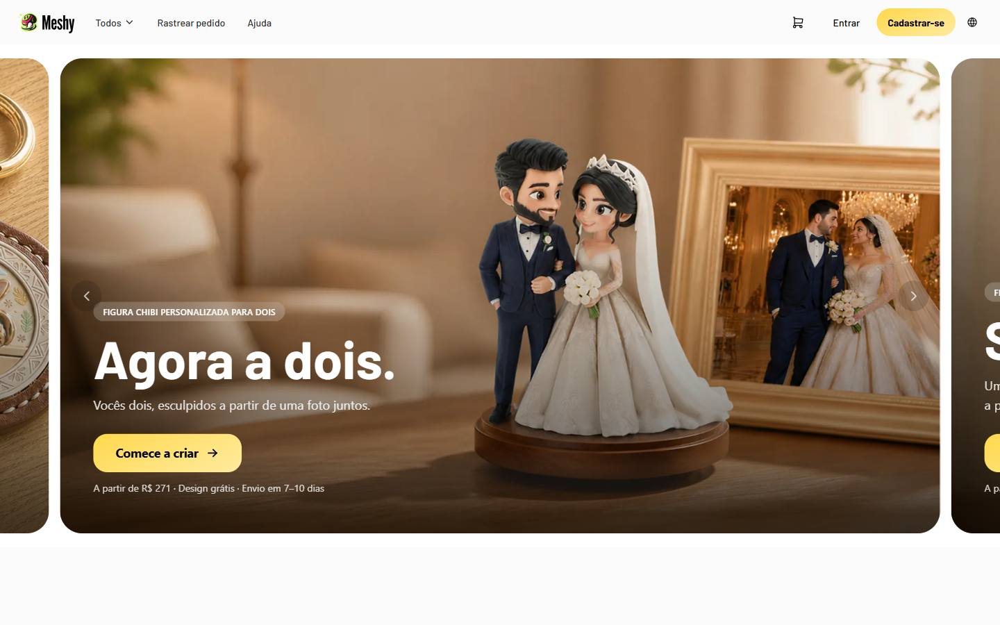
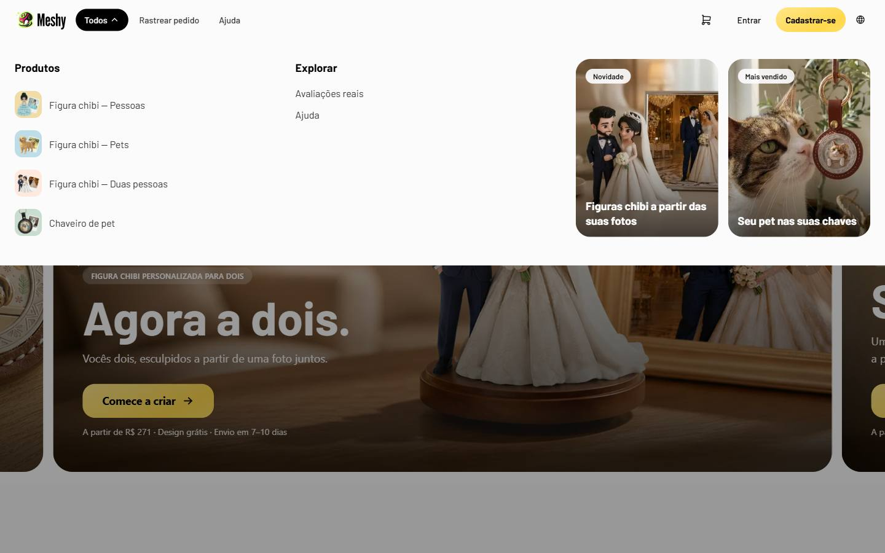

Os depoimentos não trazem data nem contagem total, e o tráfego capturado não mostrou nenhum serviço de avaliação de terceiros. Os 28 botões "Comprar igual" só levam à página do produto, sem pré-selecionar nada. As peças de marketing incluem uma figura da **Harley Quinn**, personagem protegido, e ela aparece até na tela de espera.

---

## 2. O criador

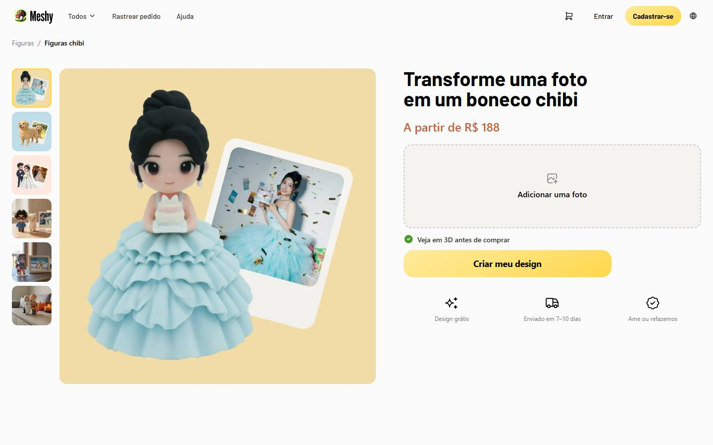

A página tem duas colunas. À esquerda fica a galeria de exemplos; à direita, o upload e o botão **Criar meu design**. Quem já tem designs vê as abas **Criar um design | Meus designs (n)**.

### 2.1 Controles

| Controle | Comportamento observado |
|---|---|
| **Adicionar uma foto** | Aceita PNG, JPG e WEBP. Depois do envio, aparece um botão "Substituir". |
| **Assunto** (`?subject=`) | Não há seletor na página: vem da URL e só muda o preço exibido. O produto real é decidido depois pelo classificador (seção 4). |
| **Nome do seu pet** | Só no chaveiro, e é opcional. |
| **Criar meu design** | O único botão. Não há número de imagens, estilo nem texto. |

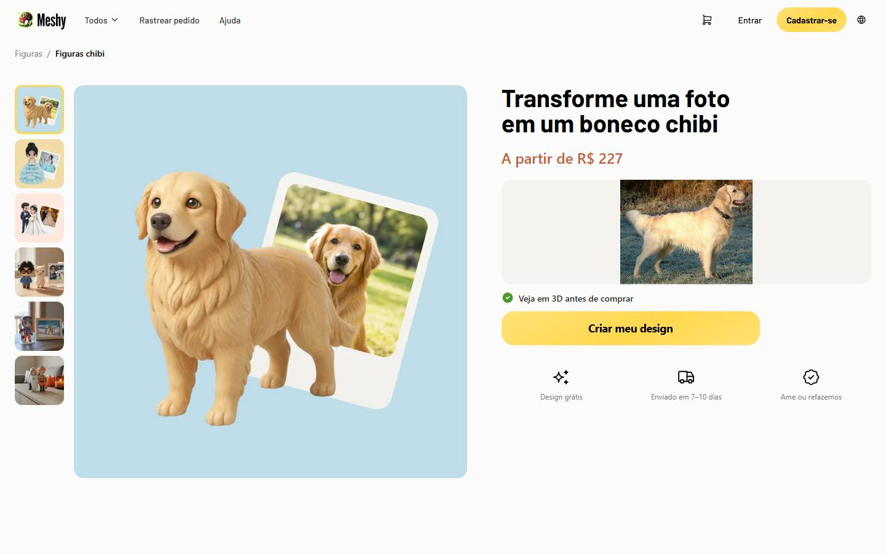
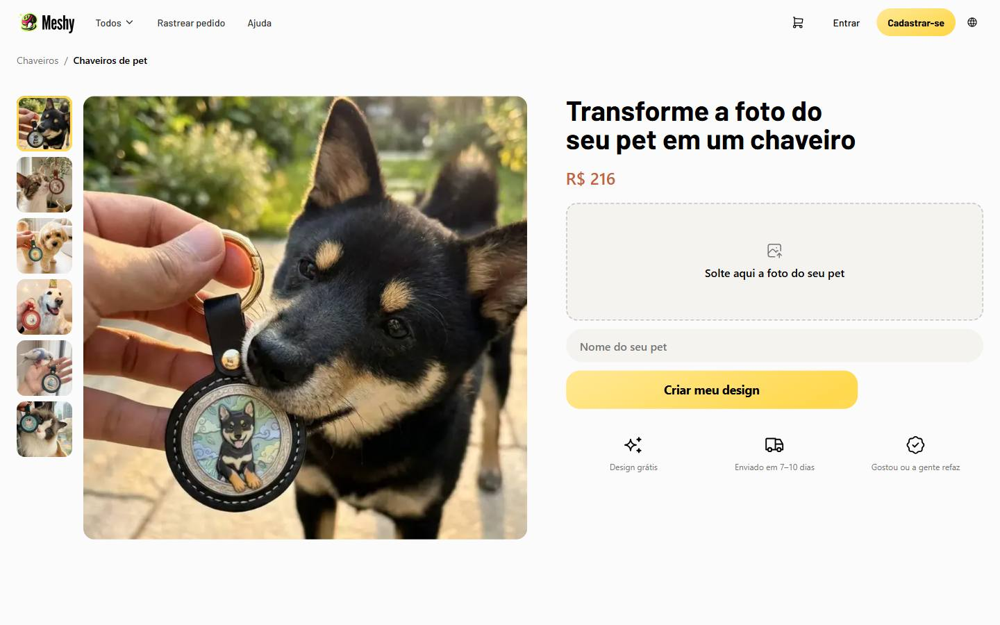

### 2.2 Design 2D: o que o usuário vê

O texto diz: *"Isso leva cerca de um minuto. Você pode continuar olhando — ele vai ficar aqui esperando você."*

| Etapa na tela | Observação |
|---|---|
| Foto enviada | Marcada logo no início |
| Fazendo o esboço dos seus designs | Com barra de progresso e depoimentos à esquerda |
| Preparando a prévia | Curta |

**Tempo medido: de ~26 a 48 s** nas 8 fotos. A barra é estimada: o campo `progress` do servidor ficou em `0` o tempo todo.

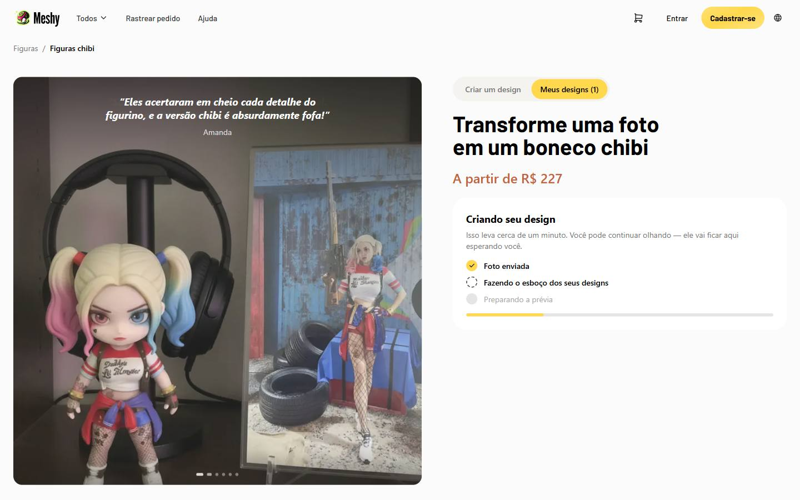

O resultado é uma grade de **4 designs de 1024×1024**, com o primeiro já selecionado. Cada foto enviada entra numa coluna de miniaturas para voltar a ela depois.

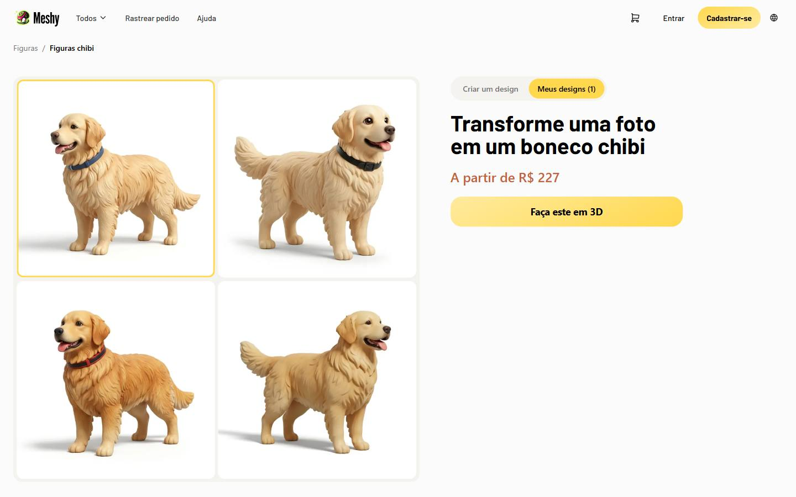

### 2.3 3D e tela de compra

"Faça este em 3D" mostra as etapas "Design escolhido → Gerando o modelo 3D → Preparando a prévia". Quando o 3D fica pronto, aparece **"Verificando sua foto…"** e depois o resultado.

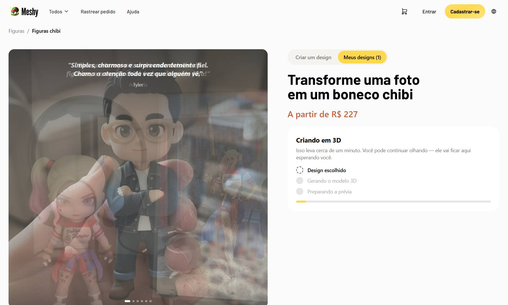
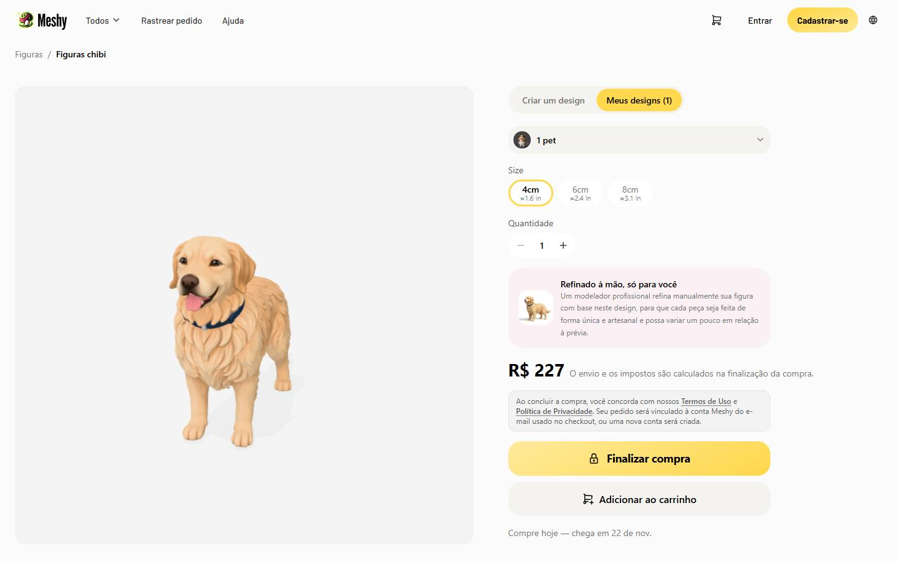

- **Visualizador:** é um `<canvas>` próprio, com rotação ao arrastar e **zoom na roda do mouse**. Não vi botão de AR nem de download.
- **Tipo:** um seletor com "1 pet" ou "1 pessoa".
- **Tamanho:** os botões mudam conforme o assunto, e **o menor vem selecionado**.
- **Quantidade**, preço, "Finalizar compra" e "Adicionar ao carrinho".
- **"Refinado à mão, só para você":** *"Um modelador profissional refina manualmente sua figura com base neste design, para que cada peça [...] possa variar um pouco em relação à prévia."* É a mesma ressalva do Jujubit.
- **"Compre hoje — chega em 22 de nov."**, numa consulta feita em 1º de novembro.

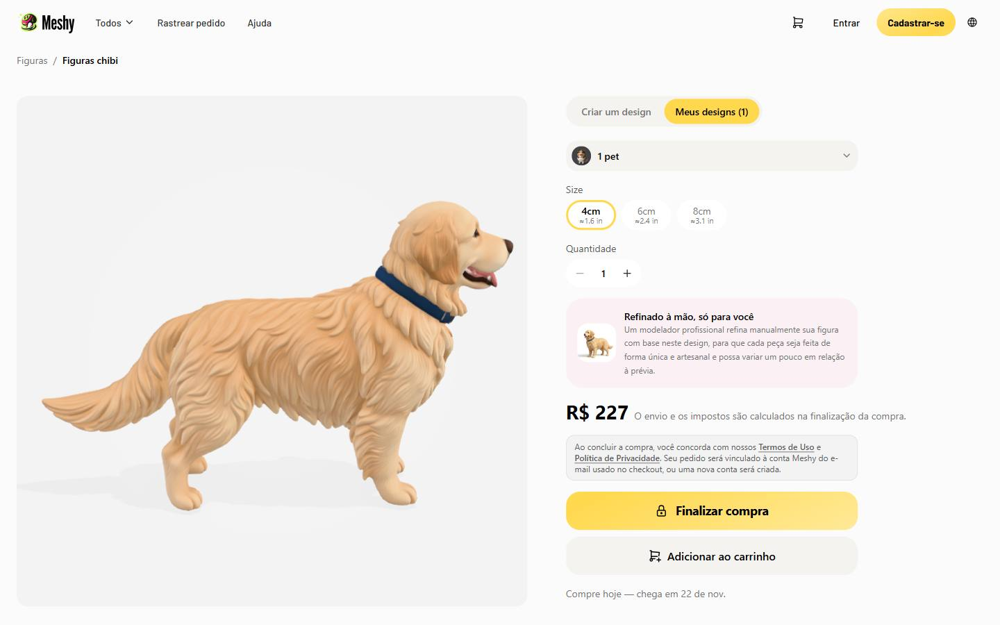

### 2.4 Persistência

Tudo sobrevive ao fechar a aba: os designs e os 3D voltam em "Meus designs", e uma tarefa em andamento é retomada. A sessão de convidado guardada no navegador vale **3 dias**. O carrinho também fica só no navegador. Não testei o que acontece com os designs depois que a sessão vence.

---

## 3. Compra

### 3.1 Preços (variantes da Shopify, consultadas em BR e US)

| Produto | Tamanho | Brasil | EUA |
|---|---|---|---|
| **Figura: 1 pessoa** | 6 cm | R$ 188 | US$ 34 |
| | 8 cm | R$ 354 | US$ 64 |
| | 10 cm | R$ 575 | US$ 104 |
| | 12 cm | R$ 851 | US$ 154 |
| **Figura: 1 pet** | 4 cm | R$ 227 | US$ 41 |
| | 6 cm | R$ 415 | US$ 75 |
| | 8 cm | R$ 801 | US$ 145 |
| **Figura: 2 pessoas** | 6 cm | R$ 271 | US$ 49 |
| | 8 cm | R$ 492 | US$ 89 |
| **Chaveiro de pet** | Único | R$ 216 | US$ 39 |

- O chaveiro tem 2 acabamentos (Brilho, Original) e 4 cores (Ônix, Rubi, Ferrugem, Verde-azulado), todos pelo mesmo preço.
- A figura de pessoa tem um "preço de" guardado (R$ 216, US$ 39 no menor tamanho), mas o site não o exibe. A diferença de US$ 5 coincide com o desconto de primeira compra da Pockella (seção 6).
- **O pet é bem mais caro que a pessoa:** 6 cm custa R$ 415 contra R$ 188.
- A home promete "a partir de 4 cm", mas a figura de pessoa só existe a partir de 6 cm.

### 3.2 Carrinho e checkout

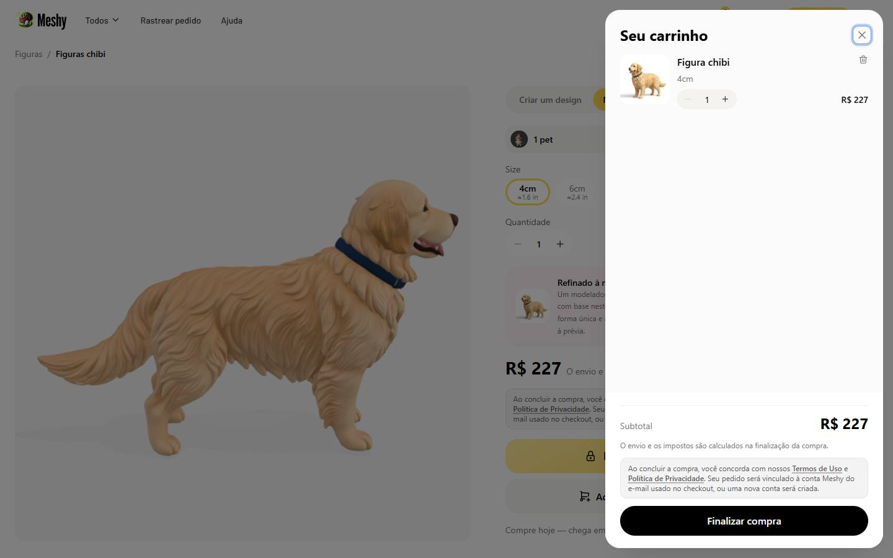
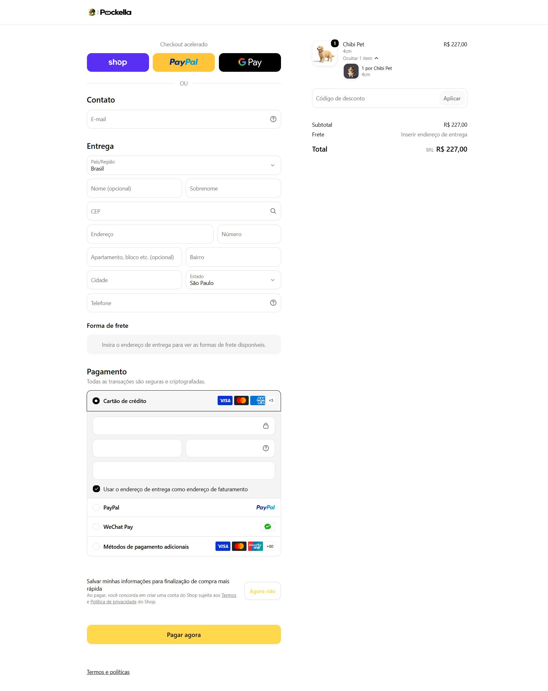

- **Gaveta lateral** com miniatura do design, tamanho, quantidade, lixeira e subtotal, sem barra de frete grátis nem urgência. Ela só existe no navegador: a Shopify só recebe o carrinho ao clicar em "Finalizar compra".
- **Checkout Shopify com a marca e o domínio da Pockella** (`checkout.pockella.com`), ainda que o cliente tenha começado no site da Meshy.
- **Pagamento:** Shop Pay, PayPal e Google Pay no topo; cartão, PayPal, WeChat Pay e "+80" métodos adicionais abaixo.
- **Países:** o seletor tem 24 países, embora o FAQ diga "enviamos para o mundo todo".
- **O pedido vira conta:** *"Seu pedido será vinculado à conta Meshy do e-mail usado no checkout, ou uma nova conta será criada."*
- **Login:** o texto é "Faça login para acompanhar seus pedidos", com Google, e-mail e código, senha, Apple, Facebook, Discord e GitHub. Serve para acompanhar pedidos, não para começar a criar. O que muda depois de entrar está na seção 11.

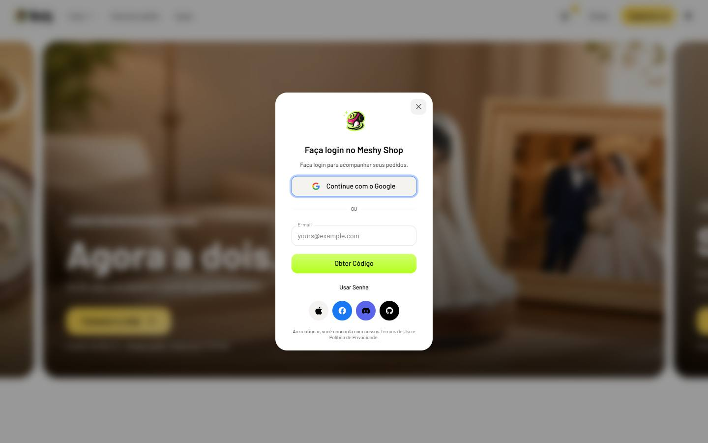

### 3.3 Frete (com endereço fictício)

| Destino | Forma | Item | Frete | Total |
|---|---|---|---|---|
| Brasil (SP) | Standard Shipping | Pet de 4 cm, R$ 227 | **R$ 26** | R$ 253 |
| EUA (NY) | Standard Shipping | Pet de 4 cm, US$ 41 | **US$ 5** | US$ 46 |
| Brasil (SP) | Frete (mobile) | 3 figuras, R$ 686 | **R$ 78** | R$ 764 |

O checkout oferece uma única forma de frete. Na única medição com mais de um item, o valor foi de R$ 26 × 3, sem desconto por juntar as peças no mesmo pedido. O preço ao consumidor é baixo e parece subsidiado, mas essa é só uma leitura minha.

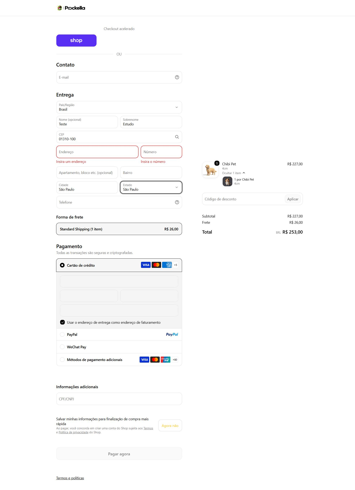

### 3.4 O que vai junto com o pedido

O item é enviado à Shopify com atributos ocultos, que formam o pacote de produção:
- foto original, design 2D escolhido e prévia do 3D;
- uma imagem 3×4 da foto;
- `_meshy_supplier_url`, a página do fornecedor;
- `_meshy_bundle_zip_url`, o pacote em ZIP;
- `_product_type` e um token de checkout.

**Atenção:** a resposta de `checkout-token`, que chega ao navegador do convidado antes de qualquer pagamento, já traz os links curtos do fornecedor e do ZIP. **Não abri esses links**, porque seria pegar o entregável sem pagar. Portanto, não sei o que eles entregam nem se exigem outra autorização.

---

## 4. O classificador de assunto

O servidor classifica o design escolhido e devolve `subject_type`. Isso define o produto, o preço e se a compra é permitida.

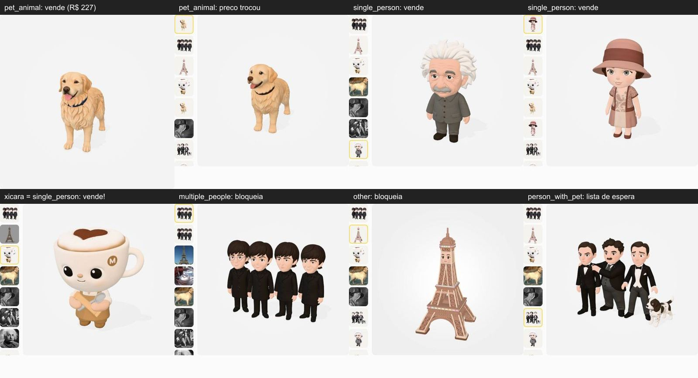

| Foto e design escolhido | `subject_type` | Resultado |
|---|---|---|
| Cachorro | `pet_animal` | À venda como "1 pet" |
| Cachorro enviado na página **de pessoa** | `pet_animal` | À venda como "1 pet". **O preço sobe sozinho de R$ 188 para R$ 227** |
| Einstein | `single_person` | À venda. O filtro de figura pública não barrou |
| Mulher em foto antiga | `single_person` | À venda |
| Casal abraçado (com login) | `two_people` | À venda por **R$ 271**, em 6 ou 8 cm |
| Xícara com carinha (design inventado pela IA) | `single_person` | **À venda como "1 pessoa", por engano** |
| 3 homens e um cachorro | `person_with_pet` | Bloqueado, com botão "Entrar na lista de espera". A classe não reflete bem os 3 homens |
| 4 pessoas (Beatles) | `multiple_people` | Bloqueado |
| Torre Eiffel | `other` | Bloqueado |

A tela de bloqueio mostra *"Não conseguimos fazer este ainda"* e as opções aceitas: 1 pessoa, 1 pet, 2 pessoas e, em breve, 1 pessoa e 1 pet.

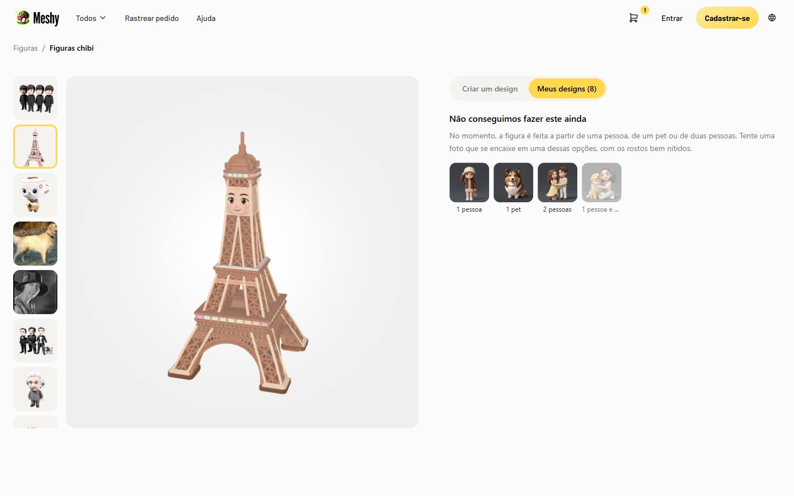
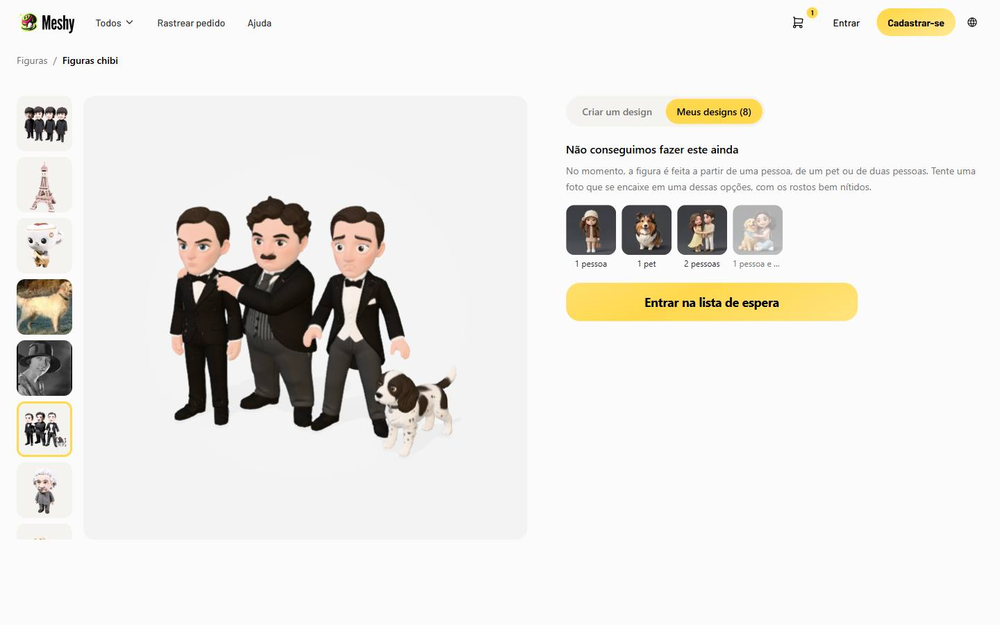

**O ponto mais importante:** o veredito apareceu **de 0 a 7 s** depois de pedir o 3D, em todos os casos, com a tarefa ainda em `IN_PROGRESS`. Mesmo assim:
- o 3D é gerado até o fim, inclusive nos casos bloqueados;
- o usuário espera 1 minuto ou mais (275 s na torre) e só então descobre que não pode comprar;
- o modelo bloqueado continua visível, e dá para girá-lo.

Nos casos acima, a loja não recusou a foto antes de gastar com 2D e 3D. O site diz "avisaremos antes de você pagar", e é verdade, mas o custo de geração já foi. A única recusa que vi antes do 3D foi a do Mickey (seção 11.3), e veio depois de cerca de 1 minuto de espera.

O código também bloqueia a compra no checkout quando o veredito não corresponde ao item do carrinho, então a regra vale além da tela.

---

## 5. Limites

| Limite | Como funciona na prática |
|---|---|
| **8 designs por dia** (convidado) | Conta **fotos**, não imagens: 8 fotos, 32 imagens. O 9º envio é recusado pelo servidor: HTTP **402** `CreativeLabFreeDesignsExhausted`. |
| **Compartilhado entre produtos** | Sem nenhum design de chaveiro feito, o primeiro envio no chaveiro também recebeu **402** `PetKeychainFreeDesignsExhausted`. |
| **Ao estourar** | O botão continua habilitado. O clique mostra *"Você já usou os designs gratuitos de hoje. Seus designs salvos ficam aqui — volte amanhã para mais."*, com um link **"Continue criando no Creative Lab"** ("Esses designs funcionam com créditos"). |
| **3D** | **Sem limite visível.** Fiz 7 depois de estourar a cota. É a brecha mais visível, como a edição era no Jujubit. |
| **Com login** | **10 designs de figura por dia** numa conta grátis, com contador separado de 16 para o chaveiro. Detalhes na seção 11.2. |

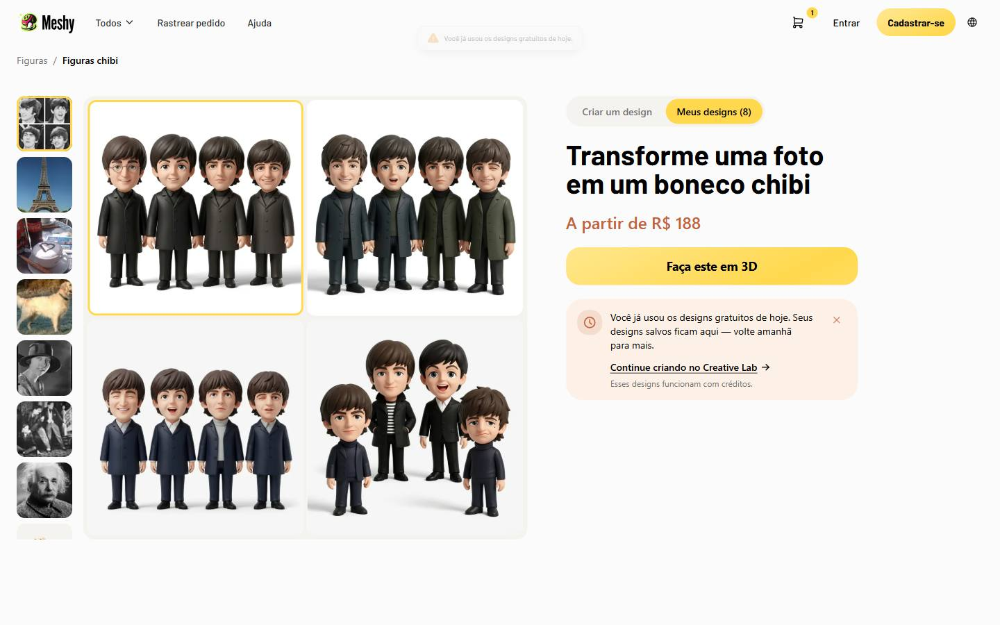
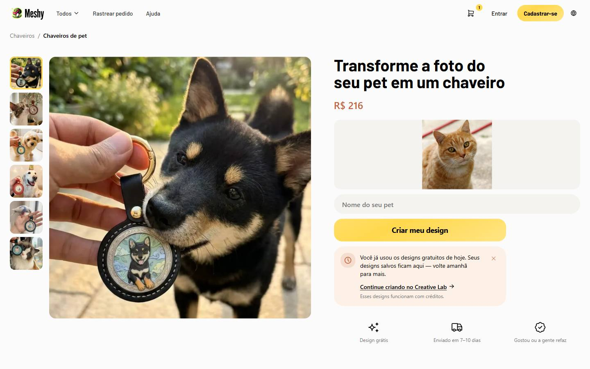

---

## 6. Pockella e Creative Lab: o que existe em volta da loja

**Pockella** (`pockella.com`, "by Meshy") é uma marca-irmã com uma faixa que a loja da Meshy não tem: *"Cerca de R$ 28 de desconto no seu primeiro pedido · autoaplicado"*. O checkout já usa o domínio dela, e o código tem a flag `pro_3398_shop_to_pockella`. Isso sugere uma migração da loja para uma marca própria de consumidor, sem o nome de ferramenta técnica.

> **Atualização de 05/11/2026:** a Pockella foi estudada à parte, em [pockella.md](../pockella/pockella.md). Ela é a loja que substitui esta: o FAQ diz que é "a loja própria da Meshy", e a página de pedidos manda para a meshy.ai os pedidos feitos antes de 12/10/2026. O site, a API e o pipeline de geração são novos (2D no fal.ai, classificador antes de gerar), e o catálogo já é maior que o desta loja.

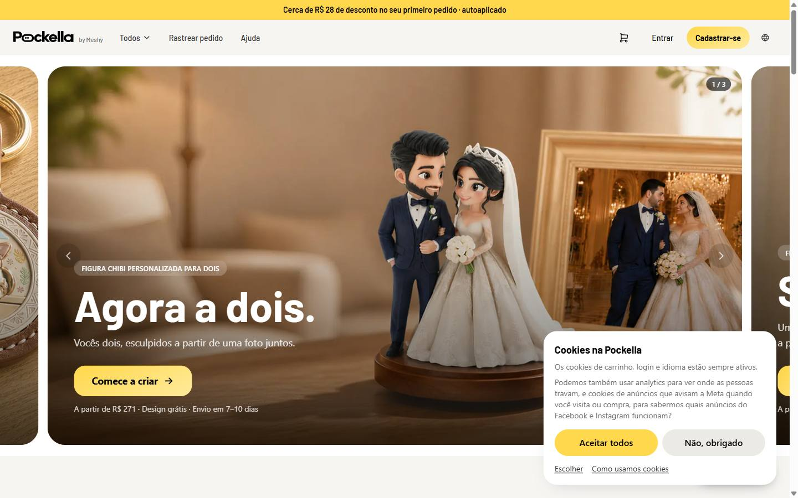

**Creative Lab** (`/creative-lab`) é o produto para quem tem conta Meshy e o pai da loja:
- 13 cartões de produto (figura chibi, vinil, chaveiro, lembrança de pet, *brick figure*, *twist egg*, luminária, keycap, fidgets, ímã, vaso, terreno), parte para receber em casa e parte para imprimir em casa;
- o mesmo fluxo Criar → Design → Prévia 3D → Finalizar compra, cobrado em créditos: figura chibi com 1 a 4 imagens, a **6 × 4 = 24 créditos**;
- exportação GLB, FBX, OBJ e STL, além de AR, segundo a própria página.

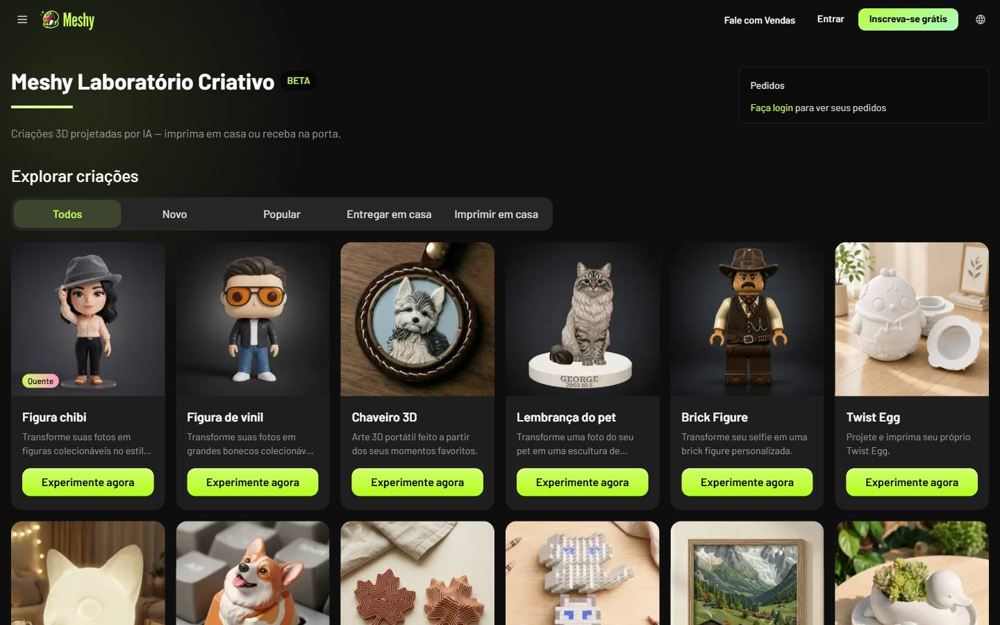
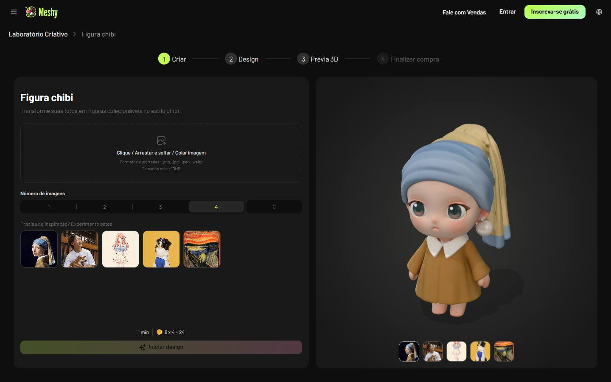

**"Para negócios"**, na mesma página: *"Nossa API transforma uma foto ou um prompt em um arquivo 3D fabricável [...]. Você traz a loja e o fulfillment. Nós garantimos que os arquivos imprimam."* Há um formulário para integração, templates personalizados e preço de volume, e a oferta menciona "apresentações de parceiros" de fabricação.

---

## 7. Políticas: FAQ contra termos

O FAQ é generoso, mas os termos escritos dizem coisas diferentes. Vale lembrar que li os termos como leigo.

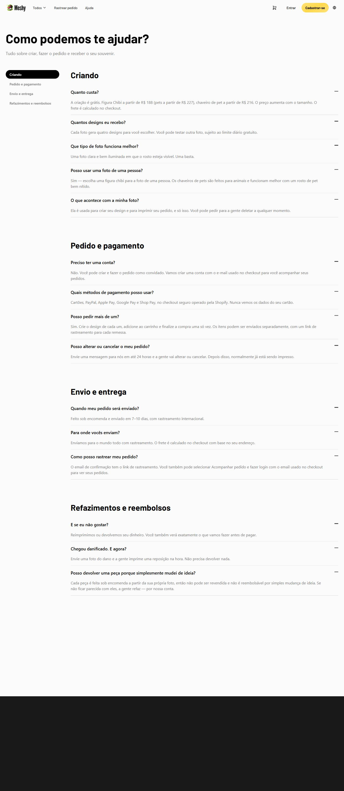

| Tema | FAQ e site | Termos (adendo de impressão, 19/09/2026, salvo indicação) |
|---|---|---|
| **Cancelamento** | "Envie uma mensagem em até 24 horas e a gente vai alterar ou cancelar." | *"Orders cannot be modified or cancelled once submitted."* |
| **Não gostou** | "Reimprimimos ou devolvemos seu dinheiro." | Pagamentos *"non-cancelable and non-refundable"*; remédios decididos pelo fornecedor, conforme as políticas dele. |
| **Responsável** | "Um humano quando você precisar... a gente refaz." | A Meshy *"does not manufacture, produce, or ship"* e se isenta de falhas do terceiro, que é o único responsável pela qualidade. |
| **Prazo para reclamar** | Não informa | Até 30 dias depois da entrega, para item com defeito material. |
| **Sua foto** | "Usada para criar seu design e para imprimir seu pedido, e só isso." | Termos gerais, s. 2.9: a Meshy pode usar entradas e saídas de clientes não Enterprise para **treinar** e melhorar os serviços, salvo opt-out por e-mail. Além disso, a resposta de `checkout-token` traz a foto original numa URL assinada com expiração em 2126. |
| **Dados pessoais** | "Envie uma foto e nós esculpimos" | Termos gerais: o usuário concorda em **não** incluir dados que identifiquem uma pessoa. A loja, porém, pede o rosto. |

**Quem fabrica:** a Meshy diz que é um terceiro. Os campos `vendor` da Shopify mostram 速哇3D摄影 (figuras) e 青岛艾利万格互联网信息科技有限公司 (chaveiros, empresa de Qingdao), e a página do fornecedor abre em chinês por padrão. O envio é internacional, com rastreamento.

**Material:** o chaveiro é detalhado na própria página: impressão industrial **ColorJet** em compósito de arenito, com selo de polímero e moldura de couro. Para a figura, o site só diz "cores completas" e "a cor fica dentro do material". Não é uma oferta de filamento FDM, e não encontrei o material exato da figura.

---

## 8. Arquitetura técnica (resumo)

> Os detalhes completos estão em **[meshy-api.md](meshy-api.md)**.

| Peça | Detalhe |
|---|---|
| Front | Next.js (Turbopack) na mesma aplicação de `meshy.ai`, com assets em `cdn.meshy.ai`, proteção AWS WAF e experimentos Statsig |
| Identidade | `POST /public/creative-lab/guest-session` devolve `guestId` e um token de 3 dias, enviado em `X-Meshy-Guest-Token`. Com login, o front usa `/web/shop/creative-lab/*` com `Authorization` |
| Design | `POST .../figure/design` (multipart, 202) e polling a cada ~3 s em `GET .../figure/tasks/{id}` |
| 3D | `POST .../figure/build {imageIds, parentId}`, o mesmo polling, e `subject_type` na resposta |
| Chaveiro | Outra rota: `POST .../generator/generate-images?product_type=pet-badge` |
| Modelo 3D | `texture_ai_model: "blueberry"`, que é o `MESHY_7` no código, e `"avocado"` (`MESHY_6`) no único casal testado. O modelo de imagem não é visível. |
| Arquivo | `model.meshy` (4,9 MB no primeiro caso), carregado via `resource/decrypt/loader-worker`. |
| Loja | Shopify Storefront API (`meshy-creative-lab.myshopify.com`), com checkout em `checkout.pockella.com` |
| Carrinho | Só no navegador, em `localStorage["meshy-shop-cart"]`, até o `cartCreate` |
| Rastreamento | Muito extenso: GA4, Google Ads, Meta, TikTok, Snap, Reddit, Criteo, AppsFlyer, AppLovin, Amazon, Yahoo Japan, Naver, Bing e o pixel da OpenAI, além de PostHog e Statsig por proxy próprio |

---

## 9. Pontos fortes e fracos (UX)

**Fortes**
- **Zero atrito:** gera e compra sem conta, e a conta nasce do e-mail do pedido.
- **Escolher entre 4 designs** dá sensação de controle e aumenta a chance de um deles agradar, sem exigir nenhuma habilidade do usuário.
- **Aprovar o 2D antes do 3D**, com o 3D em ~1 min. É bem mais rápido que os ~2,5 min do Jujubit.
- **Tom de presente** coerente, com pouca pressão e garantia sempre visível.
- **Prévia protegida:** dá para girar e dar zoom sem entregar o arquivo.
- **Um único produto por assunto**, escolhido sozinho pelo classificador.

**Fracos**
- **O veredito existe em segundos, mas o usuário descobre o bloqueio mais de 1 minuto depois**, e o provedor já pagou o 3D.
- **O preço muda depois do 3D** quando o assunto não corresponde à página (R$ 188 vira R$ 227).
- **O classificador erra:** xícara como pessoa, 3 homens e um cachorro como "pessoa com pet".
- **Design inventado:** a foto da xícara gerou 3 designs com pessoas que não existem, um deles com garrafa de Coca-Cola e cartão. O 3D da torre ganhou um rosto. Nenhum aviso.
- **O "chibi" de pet não é chibi:** o cachorro saiu como miniatura realista.
- **Sem ajuste:** se nenhum dos 4 agradar, é preciso gastar outra das 8 tentativas.
- **Recusa sem motivo:** o Mickey só recebeu "Não deu certo. Tente outra foto.", depois de ~1 min, e o aviso aparece embaixo de outro design (seção 11.3).
- **Chaveiro sem 3D e com texto inventado:** a compra é feita só com a imagem, e um dos 4 designs do gato ganhou "Feline Fidelity · 2024" na borda sem ninguém pedir.
- **Mobile:** a geração começa assim que a foto é escolhida, sem confirmação (seção 12). Para quem não está logado, o pop-up de login do Google cobre o botão "Faça este em 3D" (print abaixo).
- **O FAQ contradiz os termos** em cancelamento, reembolso e uso da foto (seção 7).

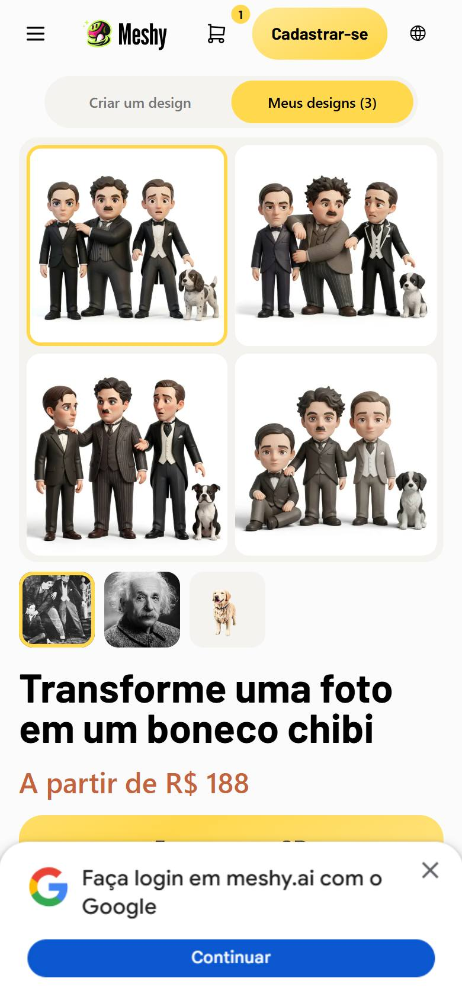

### Resultados 2D

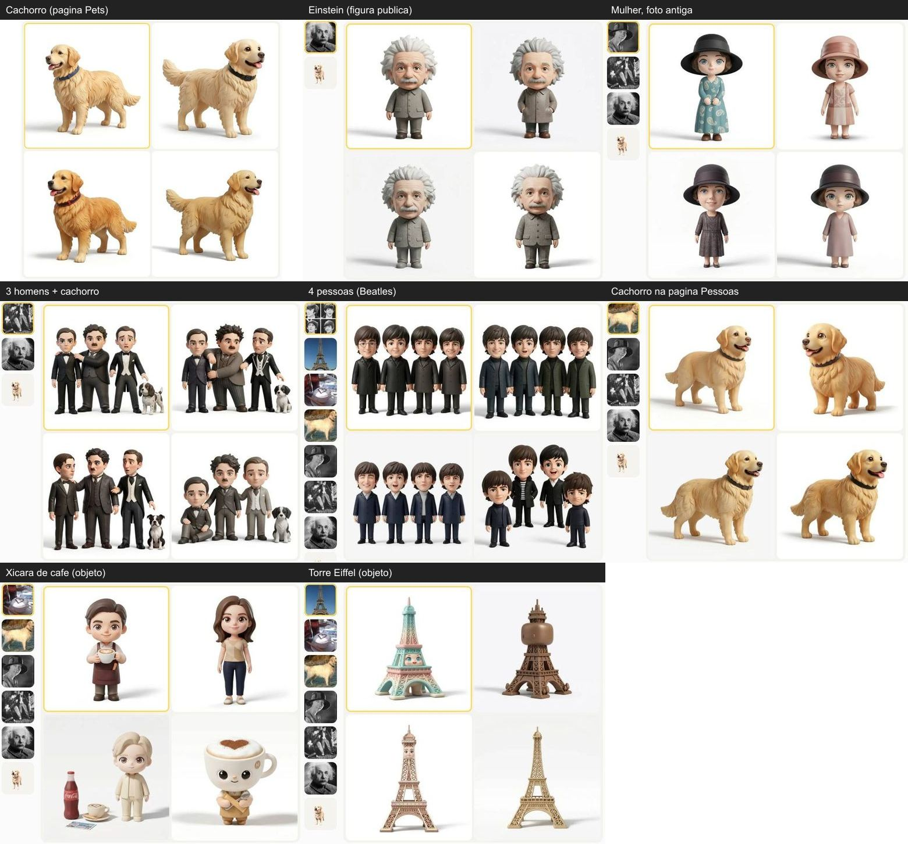

| Foto | Resultado |
|---|---|
| Cachorro | Bom e fiel, mas a coleira muda de cor entre os designs, inclusive para vermelha. |
| Pessoa conhecida (Einstein) | Muito parecida e consistente nas 4 opções |
| Mulher em foto antiga (P&B) | Rosto genérico. Cores e roupas são inventadas, e variam muito entre os 4 |
| 3 homens e um cachorro | Mantém todos os assuntos. O próprio bloqueio vem depois |
| 4 pessoas | Mantém os 4, e três designs saem quase iguais na pose |
| Objeto (xícara) | **Muito instável**: cada design interpreta de um jeito, com pessoas inventadas |
| Objeto (torre) | A forma é reconhecível, mas alguns designs ganham um rosto ou mudam de estrutura |

---

## 10. O que isso sugere para o Kubo

1. **O fluxo-alvo do Kubo tem um concorrente real, e funcionando:** imagem → aprovar 2D → 3D → comprar. Isso valida o desenho e tira a dúvida levantada no estudo do Jujubit sobre pular a aprovação.
2. **Testar 4 opções em vez de 1.** Escolher entre 4 é simples, mas custa 4 imagens por tentativa. Vale um teste no protótipo, junto com a edição por chat, que a Meshy não tem e é uma diferença real do Kubo.
3. **Classificar antes de gastar.** A lição mais barata deste estudo: o Kubo deve checar o assunto logo na foto ou no design aprovado e parar antes do 3D. Hoje o protótipo não restringe assunto, então isso só importa quando houver regra de venda.
4. **Mostrar o preço certo cedo.** Se o preço depende do assunto, ele não pode mudar depois de 1 minuto de espera.
5. **Proteger a prévia.** Vale avaliar um formato ou uma entrega que não exponha o GLB completo, ou ao menos uma prévia de baixa resolução, já que o modelo é o entregável.
6. **Não mandar links de produção ao navegador.** Links de fornecedor e pacote devem ser criados no servidor, depois do pagamento.
7. **Limitar o 3D também.** O 3D é a etapa cara, e a cota deve valer para ele. Vale manter a boa ideia da cota única por usuário, somando todos os produtos.
8. **Dependência de provedor: a questão que merece decisão.** O plano atual é usar só a Meshy no 3D, e a Meshy é concorrente direta no produto final. O [relatório de endpoints](../../../fornecedores-3d/comparativo/Endpoints%20Tripo%20AI%20e%20Meshy.md) já deixa em aberto se um marketplace de impressão é "produto concorrente" pela s. 2.6(iv) dos termos. A oferta "para negócios" aponta para o outro lado, mas não responde à dúvida. **Sugestão: perguntar à Meshy por escrito** pelo formulário de integração, antes de investir mais nesse caminho.
9. **API equivalente.** Os nomes internos `figure-prototype` e `figure-build` batem com `POST /prototype` e `/build` do Creative Lab Figure documentados no relatório (6 créditos por imagem e 30 no build). Seria um atalho para testar a mesma qualidade, com a ressalva do próprio relatório: é chibi e não tem parâmetro de tamanho. O fluxo-alvo do Kubo, com análise, reparo e multicolor, usa outros endpoints.
10. **Onde o Kubo pode diferenciar:**
    - **prazo:** 21 dias na tela da Meshy, contra produção local;
    - **assunto:** a Meshy vende só pessoas e pets; objetos ficam de fora, e no Jujubit eram o ponto forte;
    - **controle:** edição por chat e troca de cores, que a Meshy não oferece;
    - **preço:** aqui a Meshy pressiona, com R$ 188 + R$ 26 para uma figura de 6 cm em cores. O custo real do Kubo em FDM ainda precisa ser comparado a isso.

### Comparação rápida com o Jujubit

| | **Jujubit** | **Meshy Shop** |
|---|---|---|
| Entrada | Foto, texto e desenho | Só foto |
| Saídas por tentativa | 1 imagem e 1 3D | 4 imagens, 3D sob demanda |
| Aprovação do 2D | Não: as duas saem juntas | **Sim** |
| Tempo até o 3D | ~2,5 min | ~30 s + escolha + ~1 min |
| Edição | Chat | Não há |
| Estilos | 7, mais templates | Só 1 |
| Assuntos | Livres | Pessoa, pet, 2 pessoas |
| Motor 3D | Tripo | Meshy 7 (próprio); Meshy 6 no casal testado |
| Arquivo da prévia | GLB aberto | `.meshy` cifrado |
| Limite grátis | 40 por dia | 8 fotos por dia (convidado), 10 por dia (conta grátis) |
| Figura de ~6 cm | US$ 69,99 (US$ 59,49 com o desconto de 15%) | US$ 34 |
| Frete | US$ 12,99 nos EUA, grátis acima de US$ 99 (FAQ) | US$ 5 nos EUA, R$ 26 no Brasil (medido) |

---

## 11. Com login: conta, cota e pedidos

Segunda sessão, em 02/11/2026, com a conta grátis (`tier: free`) do Jeferson. Ele mesmo fez o login, e a captura de rede só foi ligada depois disso. Nenhum pedido foi pago.

**Resumo:** **a loja quase não muda com login.** O criador, os preços e a compra são os mesmos. Entrar acrescenta três coisas:
- uma cota própria, um pouco maior;
- designs guardados na conta;
- a lista de pedidos.

A loja não tem perfil, endereços, favoritos nem cupons. O menu da conta só mostra o e-mail, **Pedidos** e **Sair**.

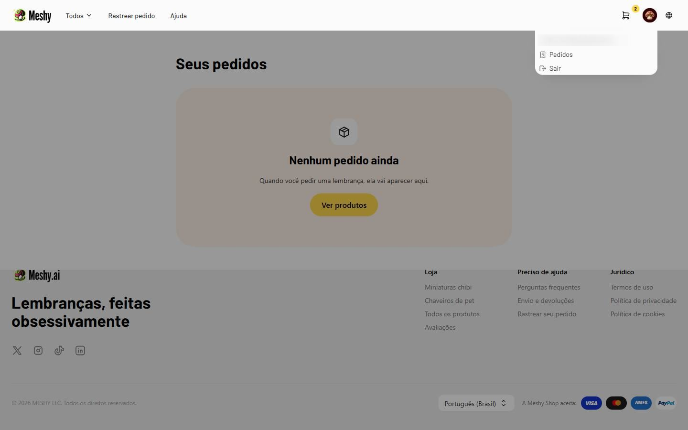
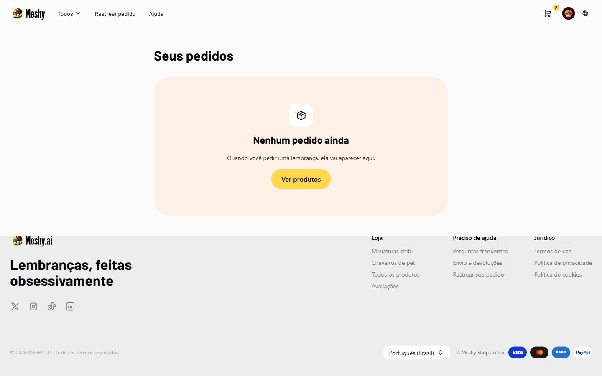

### 11.1 O que muda ao fazer login

| Item | Sem login | Com login |
|---|---|---|
| **Identidade** | Token de convidado no navegador | `Authorization` da conta. As mesmas operações usam a rota `/web/shop/creative-lab/*`. |
| **Cota de designs** | 8 fotos por dia, somando os produtos | 10 designs de figura por dia, mais um contador separado de 16 para o chaveiro |
| **Renovação** | Não medida | `reset_at` às **00:00 UTC, 21h em Brasília** |
| **Créditos da conta** | Não se aplica | **Não são usados.** O saldo ficou igual depois de 8 tentativas de design e 5 modelos 3D. |
| **Histórico** | No navegador | Na conta. Os designs feitos como convidado no mesmo navegador **não passaram para a conta**. |
| **Carrinho** | No navegador | Continua no navegador. O item de convidado continuou lá depois do login, ao lado dos itens da conta. |
| **Checkout** | E-mail digitado à mão | Igual: o carrinho vai à Shopify sem `buyerIdentity`, e o campo de e-mail abre vazio. |
| **Pedidos** | Pede login | Lista os pedidos da conta. Sem nenhum, mostra "Nenhum pedido ainda". |
| **Cabeçalho** | Entrar e Cadastrar-se | Avatar com o menu da conta |

Como o checkout não recebe a sessão, o pedido se liga à conta **pelo e-mail digitado**, conforme o aviso do carrinho. Quem digitar outro e-mail deve criar outra conta, mas não fiz um pedido para confirmar.

### 11.2 Cota: o que medi

| Ação | Contador da figura |
|---|---|
| Início do dia | 0 de 10 |
| Casal, design pronto | 1 |
| Mickey em andamento | 2 |
| Mickey recusado | **volta para 1** |
| Arquivo que não é imagem (HTTP 400) | não conta |
| Mulher, Einstein, Beatles e 3 homens com cachorro | **5 no fim** |
| 5 modelos 3D | não contam |

- **A recusa devolve a cota**, e o design recusado some de "Meus designs".
- **O chaveiro não mexeu em nenhum contador:** seguiu em 0 de 16 depois de um design pronto, até o fim da sessão. Não sei se é um atraso, um erro ou uma regra.
- **Não estourei a cota da conta**, então não sei o que aparece no 11º design.
- **Não dá para dizer que o login contorna o limite de convidado.** A cota de convidado estourou em 01/11 e o teste com login só veio depois das 00:00 UTC, quando ela já pode ter renovado.

### 11.3 Os casos que o limite tinha barrado

**Duas pessoas: funciona, mas foi o caso mais lento.** A foto de um casal abraçado gerou 4 designs em 38 s, fiéis às duas pessoas. O 3D foi classificado como `two_people` em 3 s e liberado por R$ 271, em 6 ou 8 cm. Dois pontos fogem do padrão:
- o 3D levou **300 s**, contra 51 a 99 s dos outros 4 feitos com login;
- saiu com **`avocado` (Meshy 6)**, enquanto os outros 12 modelos do estudo usaram `blueberry` (Meshy 7).

É um único caso, e o pedido de 3D é igual ao dos outros. Não sei se é uma regra para duplas ou um experimento.

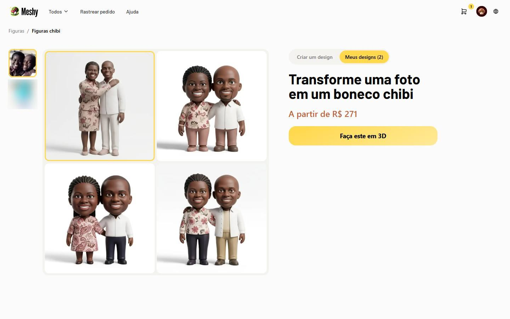

**Chaveiro: não tem etapa 3D.** Uma foto de gato gerou 4 designs de medalhão em relevo em 58 s. "Pedir este" abre direto a compra: acabamento (Brilho ou Original), cor do couro, quantidade e R$ 216. O cliente **compra vendo só a imagem**, e o passo a passo da página também não cita 3D.

Um dos 4 designs inventou um texto na borda, "Feline Fidelity · 2024 · Serene Spirit", sem nenhum nome informado. O teste foi só com esse gato.

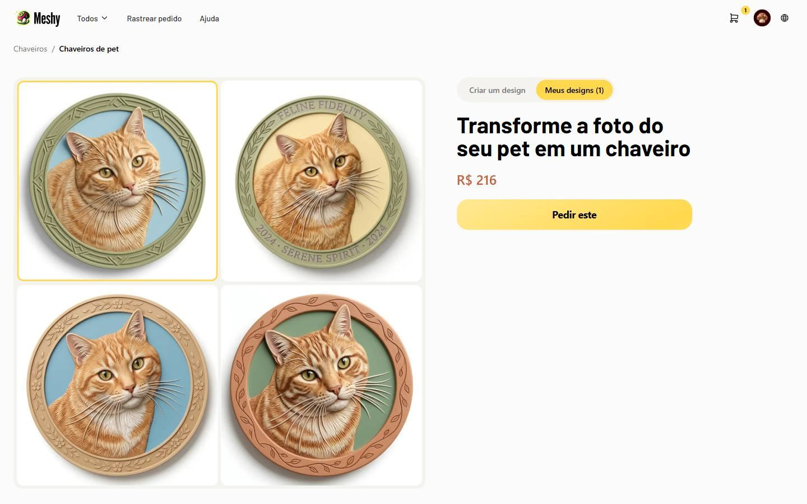
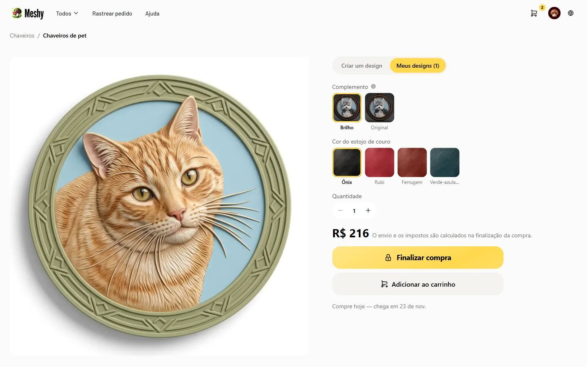

**Personagem protegido: o Mickey foi recusado no 2D.** Enviei duas vezes a mesma imagem de *Steamboat Willie* (1928):
- depois de cerca de 1 min, a tarefa falhou com `provider_content_refused` e mensagem `422`;
- a tela mostrou só **"Não deu certo. Tente outra foto."**, embaixo do design que ficou aberto. No print, o aviso está na página de compra do casal, sem relação com o pedido;
- o modal de propriedade intelectual que existe no código não apareceu.

O nome do erro sugere que quem recusou foi o provedor do modelo de imagem, e não um filtro da loja, mas isso é inferência. Foi uma única imagem: não dá para concluir como a loja trata outros personagens, e conteúdo impróprio não foi testado.

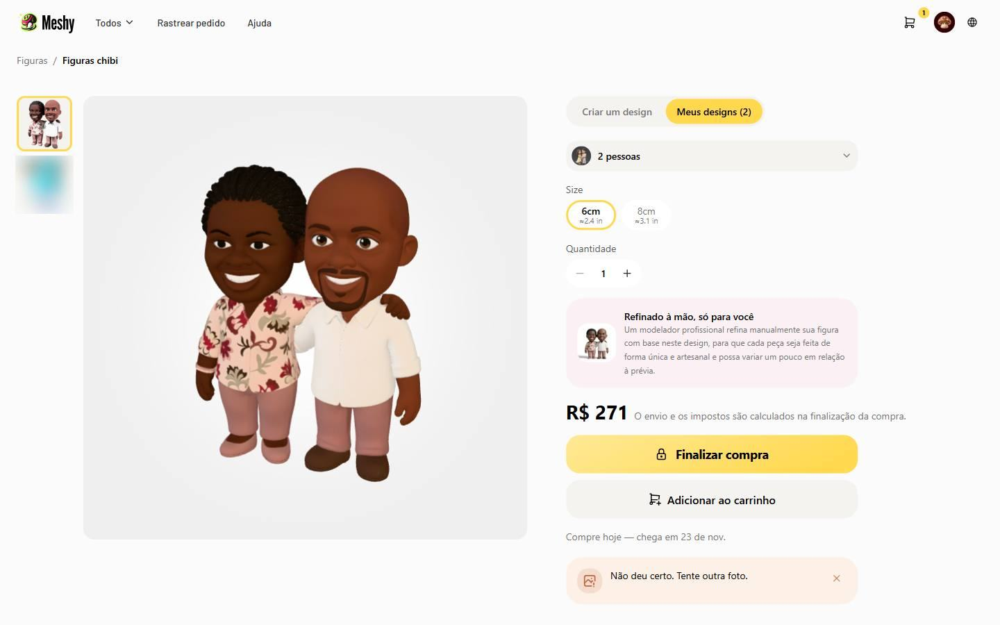

### 11.4 O que isso sugere para o Kubo

- **Devolver a cota quando a geração é recusada.** A regra é simples e justa: conta só o que foi entregue.
- **Explicar a recusa.** "Tente outra foto" não ajuda quem enviou um personagem, porque qualquer outra foto dele vai falhar igual. E o aviso deve aparecer junto do pedido que falhou.
- **Juntar o histórico ao entrar.** Na Meshy, quem cria como convidado e depois faz login não vê mais esses designs na conta. O Jujubit junta o histórico do navegador à conta.
- **Conta opcional é viável.** A Meshy vende sem conta e liga o pedido pelo e-mail. A vantagem de entrar é pequena (de 8 para 10 designs), então o login não pressiona a compra.

---

## 12. Versão mobile

Chrome em emulação de celular: 390×844, toque e identificação de iPhone. **Não é um aparelho real**, então o desempenho não vale como medida. As páginas públicas foram vistas sem login, e o fluxo de criação, na conta.

Sem prints das telas de limite estourado (14 e 15), a pedido do Jeferson, nem dos quadros comparativos 90 e 91, que são montagens.

**O que muda em relação ao desktop:**

| Ponto | Mobile |
|---|---|
| **Início da geração** | **Escolher a foto já dispara a geração.** Não há a etapa de ver a foto, trocá-la e tocar em "Criar meu design". Uma foto errada gasta uma tentativa. Medi isso na figura. |
| **Página do produto** | Uma coluna, com o exemplo no topo e o botão "Envie uma foto para começar" logo abaixo |
| **Miniaturas dos designs** | Linha horizontal abaixo do design, em vez da coluna à esquerda |
| **Espera** | Quadro de etapas e carrossel de depoimentos em tela cheia |
| **Visualizador 3D** | A pinça aumenta o modelo sem ampliar a página |
| **Compra** | "Finalizar compra" e "Adicionar ao carrinho" aparecem na primeira tela, sem rolar |
| **Menu** | Tela cheia, com busca de produtos |
| **Cabeçalho sem login** | Menu, carrinho, "Cadastrar-se" e idioma |
| **Carrinho** | Gaveta que ocupa quase toda a tela |
| **Checkout** | Shopify responsivo, com Shop Pay, PayPal e Google Pay no topo. O e-mail abre vazio. |
| **Pop-ups sem login** | O login do Google cobre parte da tela, inclusive o botão de 3D. Na Pockella, o aviso de cookies também ocupa boa parte da primeira tela. |

O pedido registra o aparelho em `_meshy_device: "mobile"`. O preço e o frete por item foram os mesmos do desktop.

### Do início à compra

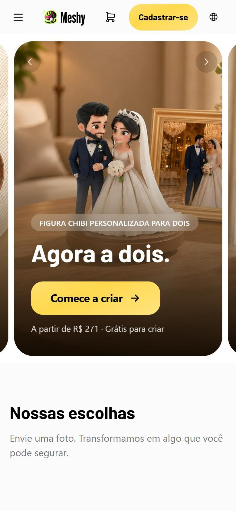 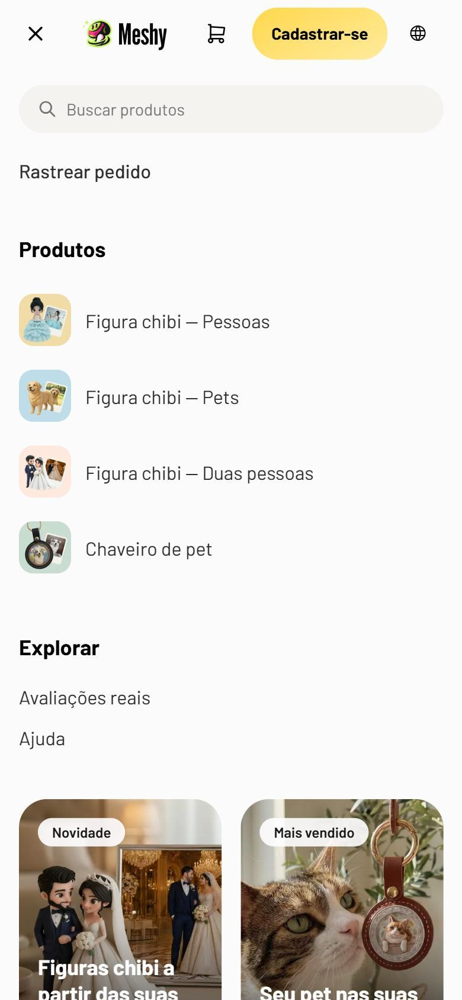 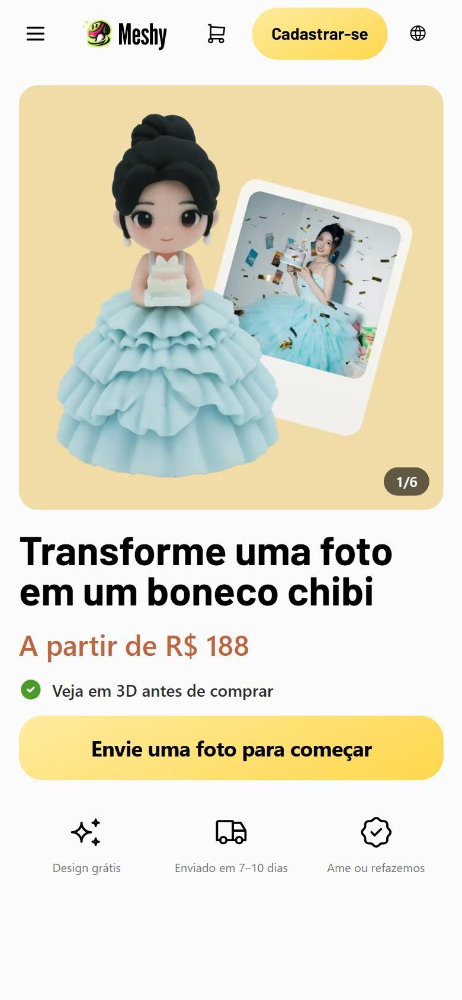 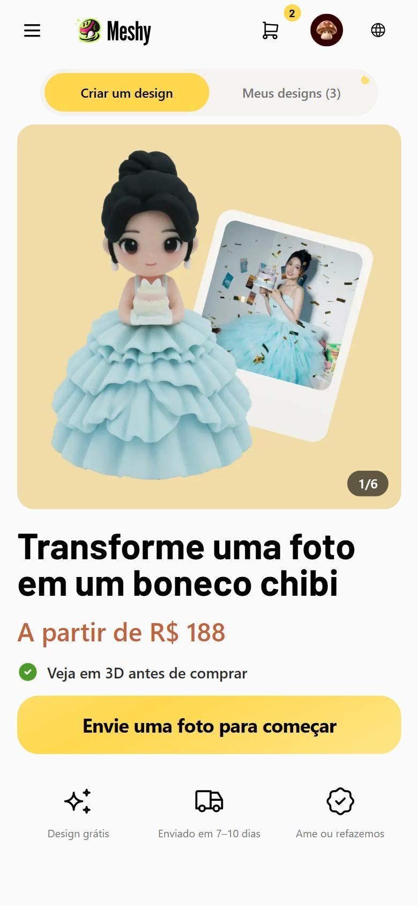

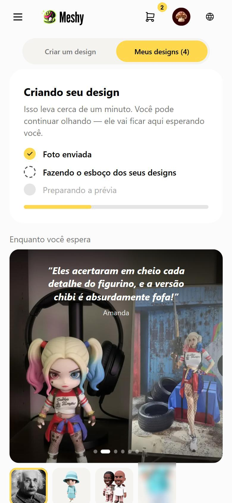 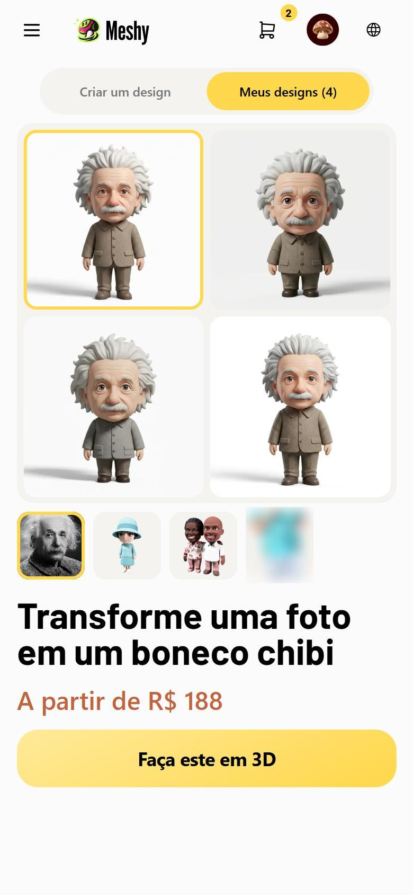 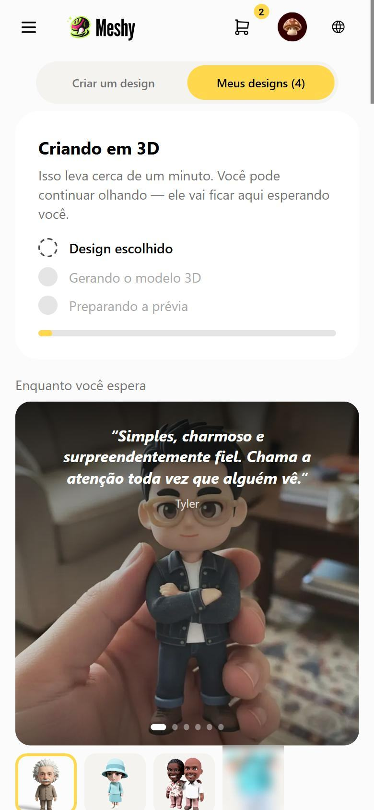 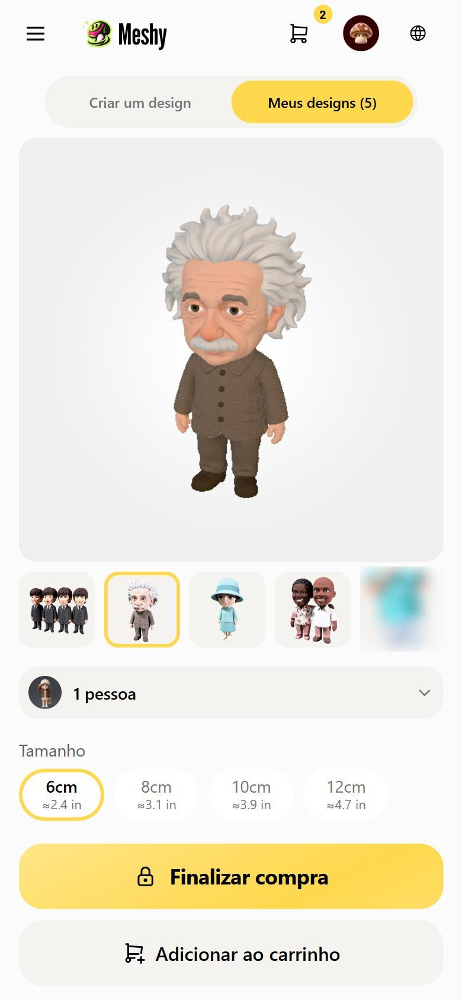

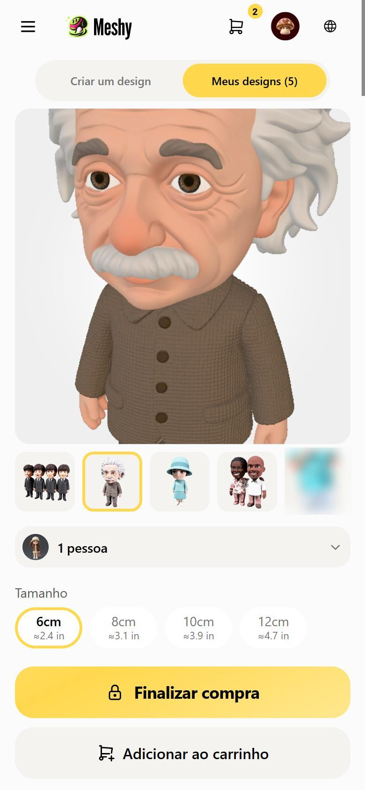 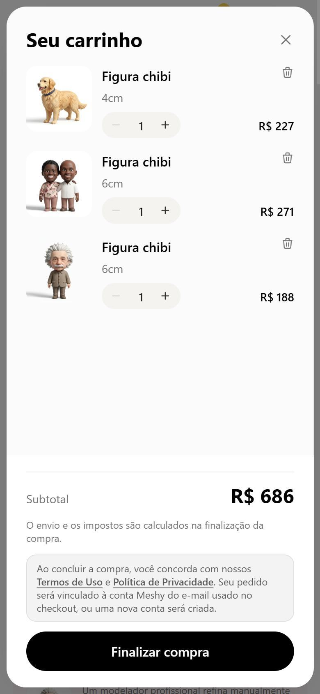 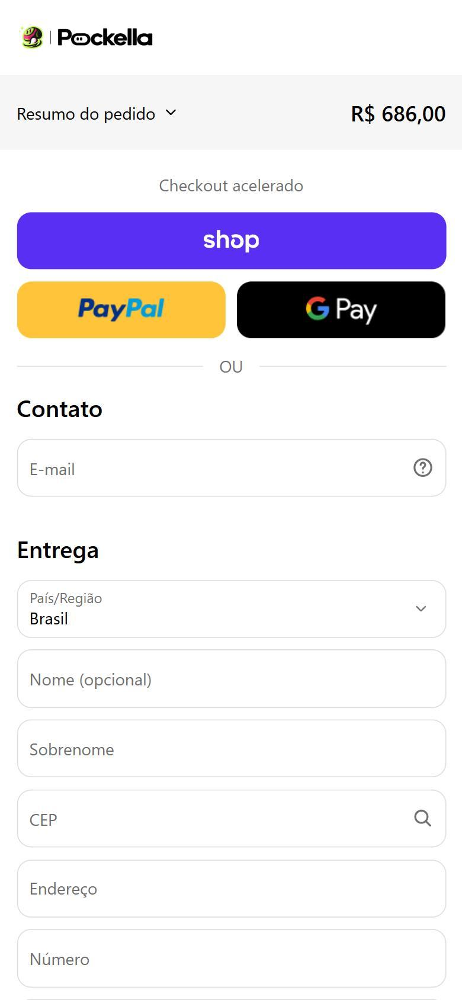 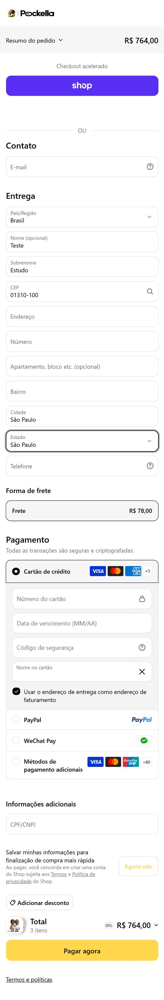

A tela de compra inteira está em [09b-3d-compra-inteira.jpg](prints/mobile/09b-3d-compra-inteira.jpg).

### Assunto bloqueado, chaveiro e conta

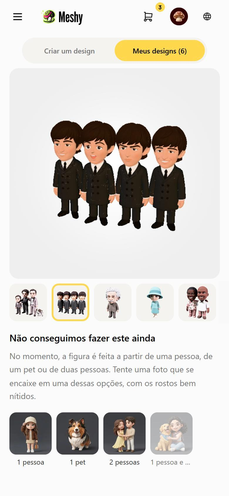 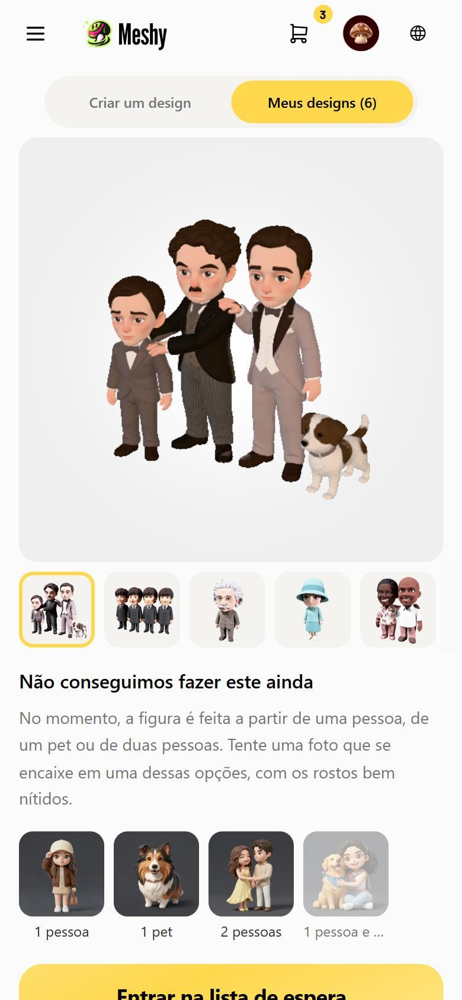 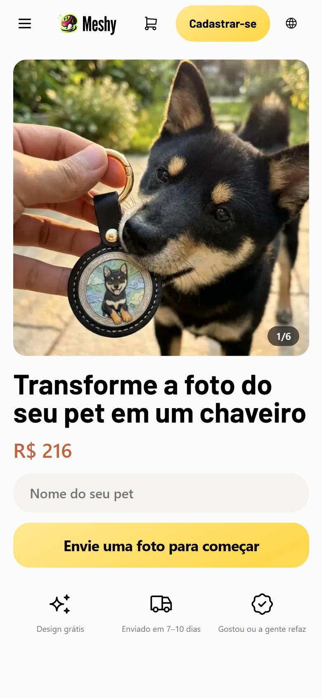 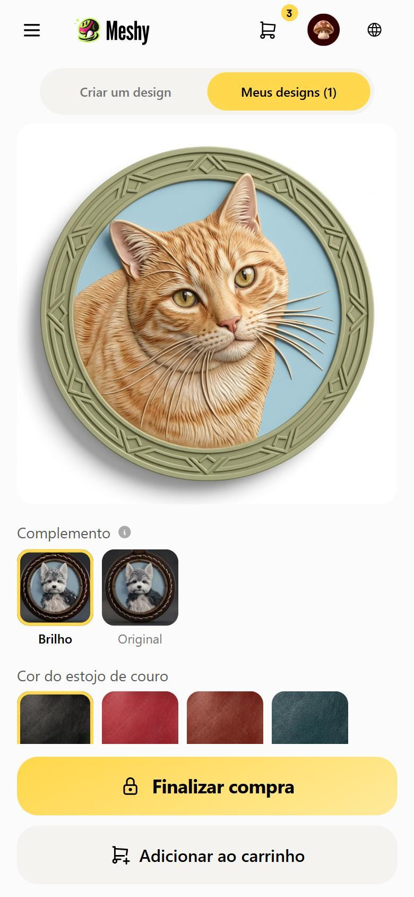

 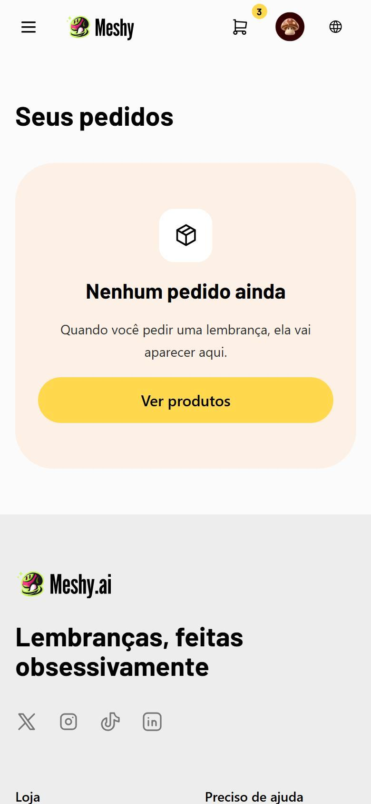 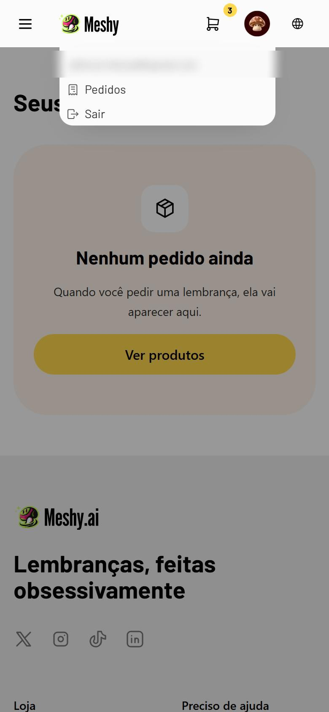 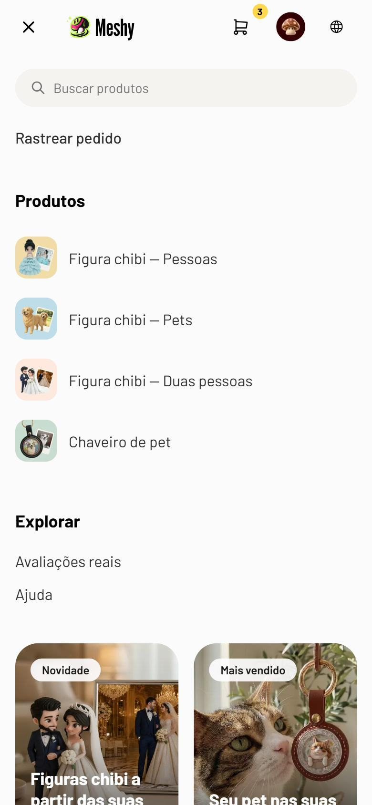

### Outras páginas

   

 

### O que isso sugere para o Kubo

- **Decidir de propósito se a geração começa ao escolher a foto.** Tira um toque, mas gasta geração e cota com fotos enviadas por engano. Se o Kubo seguir esse caminho, precisa de um jeito rápido de cancelar.
- **A primeira tela mobile já leva à ação:** exemplo, preço e um único botão. É um bom modelo para o protótipo.
- **Evitar pop-ups de terceiros sobre o botão principal.** O caso do Google mostra o risco de carregar login automático na tela de criação.

---

### Como este estudo foi feito / limites

- Um Chrome separado (perfil temporário), controlado com puppeteer; prints e rede capturados por script. A captura ficou desligada durante o login.
- **Fotos de teste:** imagens do Wikimedia Commons, baixadas para este estudo, inclusive de pessoas conhecidas (Einstein, Beatles, Laurel & Hardy), uma mulher não identificada em foto antiga e um casal em foto de domínio público.
- **Dados da conta:** o e-mail e a miniatura de um design pessoal, que a conta já tinha antes dos testes, estão borrados nos prints. Esse design não foi usado nem alterado. As tarefas de teste continuam em "Meus designs" da conta, porque não apaguei nada.
- **Não fiz nenhum pagamento.** No checkout, usei nome e endereços fictícios, sem e-mail nem dados de pagamento, só para ver o frete. Sem login, ficou um carrinho anônimo; com login, um checkout mobile aberto de 3 itens. Nenhum deles virou pedido.
- **Consultei o catálogo diretamente** na API pública da Shopify, com o mesmo token público que a página usa, em busca de variantes e preços. Foi leitura de dados públicos.

**O que deixei de fazer de propósito:**
- **Não decifrei o `model.meshy`.** Por isso, ao contrário do Jujubit, **não há números de malha** (faces, texturas, tamanho real), nem garantia sobre a qualidade do arquivo final.
- **Não abri os links do fornecedor e do pacote ZIP.**
- **Não troquei de perfil ou sessão para contornar o limite de convidado.** Assim, não sei se essa cota segue o navegador, o dispositivo ou o IP. O `guestId` tem formato de UUID v5, que é derivado de algo, mas não testei do quê.
- **Não cliquei em "Entrar na lista de espera".**

**O que ficou de fora:**
- O 11º design da conta, a renovação da cota vista na prática e um pedido real, com a página de pedido preenchida e a peça física.
- O que "refinado à mão" significa na prática.
- Moderação de conteúdo impróprio e de figura pública barrada. Os códigos `FORBIDDEN_FOR_PUBLIC_FIGURE`, `..._INTELLECTUAL_PROPERTY` e `..._NSFW` existem no código, mas não os vi em ação. O Einstein não foi barrado.
- Planos pagos e o Creative Lab com login: a conta usada é grátis, e o foco foi a loja.
- Aparelho real: o mobile foi emulado.
- A frequência de erro do classificador: são poucos casos, escolhidos para forçar os limites, então não é uma taxa. O mesmo vale para o casal e o Mickey, com uma imagem cada.

**Evidência indireta:**
- **Meshy 7 e Meshy 6:** o campo `texture_ai_model` da API mais o mapa de nomes no código do site.
- **Fabricantes:** os campos `vendor` da Shopify somados à afirmação dos termos de que um terceiro fabrica.
